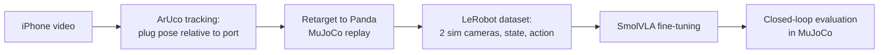

# MimicVLA

Phone recordings of a person plugging in a USB stick, turned into Franka Panda
demonstrations in MuJoCo and used to fine-tune SmolVLA. The policy inserts the
plug in closed loop about half the time from start poses no model trained on.

**[Results, design choices, and what did and didn't work → RESULTS.md](RESULTS.md)**


## How it works



The phone video is used only to measure the human's plug motion relative to
the port. The Panda replays that motion in simulation, and the replay's
rendered images, joint states and actions form the training data. The policy
sees two simulated cameras, the robot state and a language instruction; it
never sees the phone video or the markers.

## Repository

| Path | Contents |
|---|---|
| `src/mimicvla/sim/` | MuJoCo scene (Menagerie Panda, USB plug, wall port, two cameras), IK controller, environment |
| `src/mimicvla/vision/` | Camera calibration, ArUco tracking, one- and two-marker pose estimation |
| `src/mimicvla/retarget.py` | Tracked plug trajectory → Panda end-effector commands |
| `src/mimicvla/data/` | Raw and LeRobot dataset export |
| `src/mimicvla/evaluation/` | Batch tracking, replay and scoring of recordings |
| `scripts/` | Pipeline stages, training, evaluation and DSRL; see [scripts/README.md](scripts/README.md) |
| `calibration/` | Printable ChArUco and ArUco sheets |
| `documentation/` | [Pipeline](documentation/pipeline.md), [experiments](documentation/experiments.md), figures and videos |
| `tests/` | Unit and integration tests |

## Setup

Python 3.12 with [uv](https://docs.astral.sh/uv/). Dependencies are locked in
`uv.lock`; the `train` group adds LeRobot 0.6.1 with SmolVLA.

```bash
uv sync --python 3.12 --group train
export MENAGERIE_CACHE_DIR=outputs/menagerie_cache   # Panda model, downloaded on first use
export MUJOCO_GL=egl                                 # headless rendering
uv run pytest -q
```

Training and evaluation were run on one RTX 5060 Ti (16 GB). Everything else
runs on a CPU.

## Quick start

```bash
# Scripted insertion in the simulator: writes outputs/sim_demo.mp4
uv run mimicvla sim-demo --output outputs/sim_demo.mp4

# Interactive viewer (Space pauses, R resets, F cycles labelled frames)
bash scripts/view_sim.sh

# Tracking test on a synthetic marker video, no phone needed
uv run mimicvla vision-smoke --output-dir outputs/vision_smoke
```

## Data

Two Hugging Face datasets, linked by clip ID:

- [`<HF_USER>/mimicvla-human-usb-raw`](https://huggingface.co/datasets/<HF_USER>/mimicvla-human-usb-raw):
  all 134 iPhone recordings (audio removed), per-frame marker and plug-tip
  poses, the camera calibration, and per-clip labels (review decision, replay
  outcome, and train/holdout/excluded split).
- [`<HF_USER>/mimicvla-panda-usb-15x7`](https://huggingface.co/datasets/<HF_USER>/mimicvla-panda-usb-15x7):
  the LeRobot v3 training set. 72 MuJoCo episodes at 20 Hz with front and
  wrist RGB (256 × 256), 9-D Panda state, 6-D Cartesian action and the task
  instruction.

## Recording your own demonstrations

Print the sheets in `calibration/`, calibrate the phone, then track a clip and
replay it on the Panda:

```bash
uv run mimicvla calibrate-camera --input charuco_video.mp4 --output outputs/iphone_calibration.json
uv run mimicvla track-video --input demo.mov --calibration outputs/iphone_calibration.json \
    --usb-marker-mm 20 --output-dir outputs/demo_001
uv run mimicvla replay-tracking --trajectory outputs/demo_001/trajectory.jsonl \
    --output-dir outputs/demo_001/replay --complete-segment
```

The replay writes `replay.mp4`, the retargeted Panda trajectory and a summary.
Marker sizes, mount offsets, recording advice and the batch pipeline
(recalibration, review, dataset export) are in
[documentation/pipeline.md](documentation/pipeline.md).

## Training and evaluation

```bash
# Fine-tune SmolVLA on the 72-episode dataset (the 8 holdout clips are excluded)
bash scripts/train_no_funnel_smolvla.sh raw_bs32_20k 20000

# 5-seed closed-loop evaluation on the 55 excluded starts
for seed in 0 1 2 3 4; do
  PYTHONPATH=scripts uv run python scripts/evaluate_policy.py \
    outputs/train/raw_bs32_20k/checkpoints/010000/pretrained_model \
    --dataset-dir outputs/eval_sets/excluded_starts_v1 --split all \
    --n-action-steps 10 --no-video --seed $seed \
    --output-dir outputs/policy_eval_multiseed/raw_10k/excluded55_seed$seed
done
```

`bash scripts/reproduce_results.sh` runs every export, training run,
evaluation and summary behind the reported numbers, in order.

## Simulation interface

`PandaUSBEnv` (`src/mimicvla/sim/env.py`) exposes `reset()`, `step(action)`,
`observation()`, `render()`, `metrics()` and `close()`.

- **Action:** 6 floats at 20 Hz, `[dx, dy, dz, rx, ry, rz]`. World-frame
  translation in metres and a world-frame rotation vector in radians, applied
  to the end-effector target. Mink solves differential IK; the Panda's
  position actuators track the joints. The plug is rigidly attached to the
  hand.
- **Observation:** `observation.state` is 7 joint angles plus 2 finger
  positions. `observation.images.camera1` (fixed front) and `camera2` (wrist)
  are 256 × 256 RGB.
- **Success:** the plug-tip centre is inside the port opening and at least
  12 mm deep. The training port is 15 × 7 mm without a funnel; the real port
  is 13.4 × 5.9 mm (see [RESULTS.md](RESULTS.md#the-tolerance-problem)).

## License

MIT. The Panda model comes from
[MuJoCo Menagerie](https://github.com/google-deepmind/mujoco_menagerie) under
its own license.
