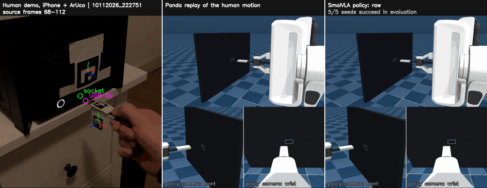

# MimicVLA

The goal of this project is to teach a robot arm a precise manipulation task
from a few phone videos of myself doing it. I recorded 134 clips of plugging a
USB stick into a computer's USB port with a handheld iPhone, turned them into
Franka Panda demonstrations in MuJoCo, and fine-tuned the SmolVLA
vision-language-action model on them. The resulting policy inserts the plug
about half the time from start poses it never trained on.

Results, engineering choices and what did not work are in
**[RESULTS.md](RESULTS.md)**.



*Left to right: the iPhone recording with marker tracking, the Panda replaying
that motion in MuJoCo, and the trained policy starting from the same pose. This
recording was never used for training. Each simulation panel shows a close
view with the policy's front and wrist cameras below it.*

## How it works

1. **Track.** ArUco markers on the plug and next to the port give the plug
   tip's pose relative to the port in every video frame. The phone can move:
   only the relative pose of the two markers is used.
2. **Replay.** That trajectory drives the Panda's hand in MuJoCo. Two simulated
   cameras record images, joint states and actions; replays that insert
   cleanly become a LeRobot dataset.
3. **Train.** SmolVLA is fine-tuned on those demonstrations.
4. **Evaluate.** The policy runs closed loop in MuJoCo from start poses taken
   from recordings it never trained on.

The policy sees only the two simulated cameras, the robot state and the
instruction "Insert the USB stick into the USB port." The phone video is used
only to measure the motion.

## Repository

```
src/mimicvla/
  vision/       camera calibration, setup files, ArUco tracking
  retarget.py   plug-tip trajectory → Panda end-effector commands
  sim/          MuJoCo scene: Panda, USB plug, wall port, two cameras, IK controller
  dataset/      build-dataset (replay, quality gate, LeRobot export), recovery
                labels, held-out split, Hugging Face download
  training/     closed-loop evaluation, DSRL, latency benchmark, result tables, videos
  cli.py        the `mimicvla` command
scripts/        train.sh, reproduce_results.sh
calibration/    printable ChArUco and marker sheets, example setup file
documentation/  data_collection.md, experiments.md (every run in detail), figures, videos
tests/          unit and integration tests
```

## Setup

Python 3.12 and [uv](https://docs.astral.sh/uv/). Training needs a GPU with
16 GB (an RTX 5060 Ti was used); everything else runs on a CPU.

```bash
git clone https://github.com/1clarkj/MimicVLA && cd MimicVLA
uv sync --group train
export MUJOCO_GL=egl                                 # headless rendering
export MENAGERIE_CACHE_DIR=outputs/menagerie_cache   # Panda model, downloaded on first use
uv run pytest -q
```

## Option A: use the published data and policy

Everything is on Hugging Face (see [Data](#data)); `mimicvla download` puts
it in `data/`.

```bash
uv run mimicvla download --policy        # training set, start states and trained policy
uv run mimicvla sim-demo                 # scripted insertion → outputs/sim_demo.mp4
uv run mimicvla sim-view                 # interactive viewer

# Evaluate the trained policy from the 55 start poses it never trained on
uv run mimicvla evaluate data/mimicvla-smolvla-usb --seeds 0 1 2 3 4

# Train your own policy (about 1 h for 10k steps on one GPU)
bash scripts/train.sh my_run 10000
uv run mimicvla evaluate outputs/train/my_run/checkpoints/last/pretrained_model
```

`mimicvla evaluate --starts holdout` uses the 8 held-out clips instead, and
`--video` saves a video of every rollout. If the viewer window does not open
on Linux, prefix it with `LIBGL_ALWAYS_SOFTWARE=1`.

To go back to the human recordings, download them as well
(`mimicvla download --raw`, 6.8 GB). They include the per-frame tracking, a
setup file per recording session and the list of clips I accepted in review,
so the training set can be rebuilt from scratch:

```bash
uv run mimicvla build-dataset data/mimicvla-human-usb-raw/tracking \
    --clips data/mimicvla-human-usb-raw/accepted_clips.txt --output outputs/datasets/rebuilt
```

This selects the same 72 episodes with the same actions as the published set.
`bash scripts/reproduce_results.sh` reruns every experiment in RESULTS.md.

How long things take on one 16 GB GPU (RTX 5060 Ti), run one after another:

| Task | Time |
|---|---|
| Evaluate the published policy, 5 seeds × 55 unseen starts | about 30 min |
| Rebuild the training set from the raw recordings | about 6 min |
| Train one policy (10k steps) and evaluate it as above | about 1.5 h |
| Everything in `reproduce_results.sh`: 5 datasets, 7 training runs, 2 DSRL runs, 15 policies × 10 evaluations | about 30 h |

The full run is dominated by evaluation (about 6 min per policy, seed and
start set). Evaluations of different policies can share one GPU.

## Option B: record your own demonstrations

You need a phone, a printer, a USB stick and a port.

**1. Print and attach the markers.** Print the two sheets in `calibration/`.
Tape a plug marker (id 0) to the USB stick and the 50 mm port marker (id 1)
flat next to the port. A second plug marker on another face of the plug is
optional but highly recommended: with one marker, the hand hides it during
insertion, and the second one raised the share of tracked frames from 70%
to 90% (see [data_collection.md](documentation/data_collection.md)).

**2. Calibrate the phone.** The camera settings must stay fixed for the
calibration and every recording, so the stock iPhone camera app does not
work: it refocuses, re-exposes and switches lenses on its own. I used
[Filmic Pro](https://www.filmicpro.com/) (free), which locks focus, exposure
and the lens. Film the flat ChArUco sheet for about 30 seconds.
Move the phone around it: tilt it about 30° left, right, up and down, film it
from near and far, and move the board into each corner of the image. Use the
same lens, zoom and resolution as for the demonstrations, and turn off video
stabilisation and automatic lens switching.

```bash
mkdir my_rig
uv run mimicvla calibrate charuco.mov --output my_rig/camera.json
```

It needs at least 6 usable views and warns when the board did not cover
enough of the image.

**3. Describe your setup.** Copy `calibration/setup_example.json` to
`my_rig/setup.json` and fill in your marker sizes and two transforms:

- `T_socket_port_marker`: where the port marker sits relative to the port
  opening (socket frame: origin at the centre of the opening, z into the port,
  x along its long side);
- `T_usb_marker_usb_tip`: where the plug's leading face sits relative to the
  plug marker (tip frame: z along the insertion direction, x along the long
  side).

Both are 4 × 4 transforms in metres, measured with a ruler. The docstring of
`src/mimicvla/vision/setup.py` defines every frame. For a second plug marker,
add `usb_marker_2`; `mimicvla fit-marker-mount` fits its transform. If you
re-tape a marker, start a new setup file: in my recordings the offset shifted
by several millimetres between sessions.

**4. Record and track.** Keep both markers in view from a few centimetres
before the port until the plug is seated.

```bash
uv run mimicvla track my_videos/*.mov --setup my_rig/setup.json   # → outputs/tracking/<video>/
```

Each recording gets `trajectory.jsonl` and `annotated.mp4`. Check the video
first: the green "socket" circle must sit on the port opening and the pink
"plug tip" circle on the plug's front face. If they are off, fix the
transforms and track again.

**5. Build the dataset and train.**

```bash
uv run mimicvla replay outputs/tracking/demo/trajectory.jsonl     # one clip → outputs/tracking/demo/replay/
uv run mimicvla build-dataset outputs/tracking --output outputs/datasets/my_set
bash scripts/train.sh my_run 10000 outputs/datasets/my_set
```

`build-dataset` keeps a recording only if its replay ends at least 12 mm
deep. Contact with the port walls is fine; only penetrating them by more
than 1 mm (a simulator artefact) or a joint limit rejects it (details:
`mimicvla build-dataset --help`).

**Optional: review the clips by eye.** The automatic check cannot tell
whether the tracking followed the real plug. `mimicvla review` opens a page
in the browser with each tracked recording next to its replay; the clips you
accept go to `accepted_clips.txt`, and you rebuild with only those:

```bash
uv run mimicvla review outputs/tracking --replays outputs/datasets/my_set_replays
uv run mimicvla build-dataset outputs/tracking --clips outputs/tracking/accepted_clips.txt \
    --output outputs/datasets/my_set_reviewed
```

The simulated port is 15 × 7 mm by default (`--port-mm`), wider than a real
USB-A port because marker tracking is not precise enough for the real one;
RESULTS.md explains why. The held-out split in `scripts/train.sh` lists clips
of my recordings; with your own data every episode is used for training.

## Data

- [`1clarkj/mimicvla-panda-usb`](https://huggingface.co/datasets/1clarkj/mimicvla-panda-usb):
  the 72-episode LeRobot training set and the evaluation start states.
- [`1clarkj/mimicvla-human-usb-raw`](https://huggingface.co/datasets/1clarkj/mimicvla-human-usb-raw):
  the 134 iPhone recordings with per-frame tracking, setup files and per-clip
  labels.
- [`1clarkj/mimicvla-smolvla-usb`](https://huggingface.co/1clarkj/mimicvla-smolvla-usb):
  the trained policy (raw labels, 10k steps).

## License

MIT. The Panda model comes from
[MuJoCo Menagerie](https://github.com/google-deepmind/mujoco_menagerie) under
its own license.
