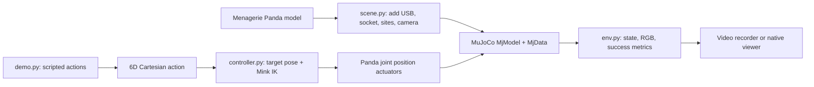

# MimicVLA

Human USB insertion demonstrations replayed on a Franka Panda in MuJoCo, with a staged LeRobot/SmolVLA training pipeline. The Panda scene, iPhone calibration, ArUco tracking, and trajectory replay run. The scene now has a flush wall and two policy cameras. The current human replays contact that wall; they are archived for inspection rather than accepted as clean policy demonstrations. Training and learned-policy inference have not been verified yet.

## Setup

Use Python 3.12. LeRobot 0.6.1, planned for the training stage, requires at least 3.12. Dependencies are locked in `uv.lock`.

```bash
uv sync --python 3.12 --group train
```

The official Panda model is supplied by `mujoco-menagerie==2026.10.1`. It downloads its versioned assets on first use. For headless Linux rendering, set `MUJOCO_GL=egl`:

```bash
MENAGERIE_CACHE_DIR=outputs/menagerie_cache MUJOCO_GL=egl uv run mimicvla sim-demo --output outputs/sim_demo.mp4
MENAGERIE_CACHE_DIR=outputs/menagerie_cache MUJOCO_GL=egl uv run pytest -q tests/test_sim.py
```

The demo writes `outputs/sim_demo.mp4` and `outputs/sim_demo.json`. The default socket opens on a **vertical face**: the plug approaches horizontally and inserts along world +X. It is a deterministic controller demonstration, not a learned policy.

To watch the same episode repeat in MuJoCo's native interactive viewer:

```bash
bash scripts/view_sim.sh
```

Drag to orbit, scroll to zoom, press Space to pause, and R to reset. Press **F** to cycle labelled site frames, the world frame, and hidden frames. Axis colours are **X red, Y green, Z blue**. Pause and zoom near `usb_tip` and `socket_target` to inspect the exact points used by success checks. Close the window to stop. This viewer shows the full 3D scene; the `sim-demo` video uses the fixed observation camera. The launcher sets two Mesa variables to work around the current NVIDIA GLX driver mismatch and chooses a local cache for the Panda model. On a machine with working OpenGL, `uv run mimicvla sim-view` is sufficient.

## Architecture



`MjModel` is the fixed scene definition. `MjData` holds the changing joints, velocities, contacts, and simulation time. On each `step`, the controller adds the six-value action to its target end-effector pose; Mink solves for a joint configuration; Panda position actuators track it while MuJoCo advances physics. The environment reads the resulting robot state, camera image, and USB/socket poses. The scripted demonstration drives both the saved video and the live viewer, so they show the same task.

## Simulation interface

`PandaUSBEnv` in `src/mimicvla/sim` exposes `reset()`, `step(action)`, `observation()`, `render()`, `metrics()`, and `close()`. `SimConfig` allows socket pose, initial end-effector offset, image size, control rate, and success tolerances to be changed. The robot comes from the official Menagerie Panda scene. The USB is rigidly attached to its hand; no grasping is simulated. Mink computes differential IK for an end-effector site, and the Panda's built-in position actuators track the resulting joint targets.

Each action is six `float` values at 20 Hz: `[dx, dy, dz, rx, ry, rz]`. Translation is in **world-frame metres**. Rotation is a **world-frame rotation vector in radians** and is left-multiplied onto the current target orientation. The gripper command is fixed closed. `observation.state` is nine values: seven arm joint angles in radians followed by two finger positions in metres. `observation.images.camera1` and `camera2` are 256×256 RGB `uint8` frames from the fixed front and hand-mounted wrist cameras when rendering is requested. `step` leaves image rendering off to keep control fast; call `observation(render=True)` for both frames.

The socket entrance frame has local +Z pointing into the socket, which is **world +X** in the default vertical-port scene. World +Z is up; the port's long side runs along world Y and short side along world Z. Specifically, socket local +X maps to world -Y and local +Y maps to world -Z. `usb_tip` is the centre of the plug's leading metal face; `socket_target` is the centre of the opening plane. Their poses are MuJoCo sites. Alignment means small radial and orientation error near the entrance. Insertion additionally requires at least 6 mm tip depth with no plug/socket contact penetrating more than 1 mm. The simplified USB-A cavity and these tolerances are prototype geometry, not measured hardware dimensions. Four collision geoms make the surrounding front wall flush with the socket mouth. `metrics()` separately reports plug/front-wall contact, penetration, and MuJoCo solver force. Inspect both camera views in `outputs/flush_wall_camera_audit.jpg`.

## Handheld iPhone tracking

The iPhone video is used to recover **motion**, not as the policy's RGB training view. Each frame estimates `T_camera_usb_marker` and `T_camera_port_marker`; their relative transform is `T_port_usb_marker = inverse(T_camera_port_marker) @ T_camera_usb_marker`. The camera may move because its pose cancels when both markers appear in the same frame. Measured marker-to-tip and marker-to-socket offsets convert that relative marker pose into a task pose. Simulated policy observations currently use a fixed overview and a wrist view of the entry.

### Why policy images come from simulation

The available real recording is a handheld monocular iPhone video of a person holding a USB stick. Its viewpoint moves, and it contains neither Panda joint states nor images from the camera arrangement the Panda will use. Pairing those frames with actions and states generated later by a simulated Panda would give the policy observations from one embodiment and viewpoint with labels from another. Under this setup and hackathon deadline, the practical consistent route is to use the calibrated markers **only to measure the human's USB-to-socket motion**, replay that motion with the Panda in MuJoCo, and collect the rendered RGB frames, actual Panda states, and controller actions together during replay. SmolVLA will receive RGB, Panda state, and language at inference; it will not receive marker poses or the demonstrated trajectory.

This choice does not remove the visual domain gap or guarantee learning. The policy will learn from simulated images and must be evaluated on held-out socket poses, starts, and camera/appearance variations. The current successful IK replay demonstrates retargeting feasibility for one segment, **not** SmolVLA success. If physical-robot deployment becomes a goal, simulation-to-real transfer needs separate evaluation.

The supplied [ChArUco sheet](calibration/charuco_calibration_A4.pdf) is 5×7 squares, 30 mm squares, 22 mm markers, IDs 10–26, `DICT_4X4_50`. The [tracking sheet](calibration/aruco_USB_and_port_A4.pdf) has USB ID 0 at four alternative sizes (12, 15, 18, 20 mm), and port ID 1 at 50 mm. Use **one** USB marker and keep other copies of ID 0 and the spare ID 1 outside the recording. Sizes refer to the outer black square. The printed 100 mm reference was checked physically; measure across several squares if you want to verify the board dimensions further.

Record a short ChArUco video while moving and tilting the board across the image, then calibrate:

```bash
uv run mimicvla calibrate-camera --input calibration_video.mp4 --output outputs/iphone_calibration.json --stride 15
```

A directory of JPG/PNG photos also works as `--input`. The command needs at least six useful views and reports the RMS reprojection error in pixels, board-centre coverage, and the focal-length difference between the first and second halves of the recording. Similar views can have a low RMS error while still giving unstable intrinsics; heed coverage and split warnings. Keep the board flat. Use the same iPhone lens, zoom, focus mode, resolution, orientation, and stabilization setting for calibration and demonstrations. Avoid automatic lens switching and digital stabilization/cropping, which may change the effective camera intrinsics. A moving phone is fine; keep **both tracking markers visible together** as often as possible. If an iPhone video fails to decode, export it as an ordinary H.264 MP4 without resizing or cropping.

After choosing a USB marker size, record a demonstration and run, for example:

```bash
uv run mimicvla track-video --input demonstration.mp4 --calibration outputs/iphone_calibration.json --usb-marker-mm 20 --output-dir outputs/demo_001
```

Use `--input 0` for a connected camera device and Ctrl+C to save and stop. The output has raw RGB frames, `trajectory.jsonl`, a copy of the calibration, `metadata.json`, `annotated.mp4` with marker axes, and `trajectory.png` showing relative XYZ in metres and rotation vector in radians. Frames with a missing marker or high reprojection error have no relative transform; no poses are filled in. Each marker record includes reprojection error and the pixel-error gap between the two planar pose solutions; a small gap signals uncertain orientation. Temporal continuity helps avoid solution flips but cannot remove that ambiguity. Calibration and demo image sizes must match. `T_A_B` maps points from B to A; camera coordinates follow OpenCV (x right, y down, z forward). The plotted rotation vector describes `T_port_usb_marker`.

Test without a phone:

```bash
uv run mimicvla vision-smoke --output-dir outputs/vision_smoke
uv run pytest -q tests/test_vision.py
```

Open `outputs/vision_smoke/tracked/trajectory.png` and `annotated.mp4` to inspect the synthetic run. The synthetic calibration is only for this test and must never be used with iPhone footage.

The first real 20 mm USB-marker test, `video_data/20mm_marker/10102026_161008.mov`, produced 173 valid relative poses from 196 decoded frames with `outputs/iphone_calibration.json`. Its outputs are in `outputs/demo_20mm_161008/`; there is an 11-frame missing-marker gap that later trajectory processing must handle. These are still **marker** poses, not USB-tip or socket-target poses.

## Marker mounts and replay

The port offset is the **port marker centre** at `[+16, -45, 0]` mm in the left socket's MuJoCo frame. The corrected USB offset is the **metal plug's leading-face centre** at `[0, +30, -3]` mm in the OpenCV-detected USB marker frame; marker +Z points out of its printed face. The target-frame orientations are inferred from the stated normal direction and a near-insertion video frame: port marker +Z points outward, opposite socket +Z inward; USB marker +Z follows tip -Y, and tip +Z follows marker +Y. Inspect them on a real frame with:

```bash
uv run mimicvla inspect-marker-frames --trajectory outputs/demo_20mm_161008/trajectory.jsonl --calibration outputs/iphone_calibration.json --frame-index 90 --output outputs/target_frame_inspection.jpg
```

The green circle marks the left socket target and magenta marks the USB tip predicted by the corrected offset. The user confirmed the points. The orientation mapping was checked against a near-insertion frame and remains an inferred rigid alignment.

### Replay a tracked demonstration

```bash
bash scripts/replay_demo.sh
```

The script sets the MuJoCo cache and headless renderer options and replays the confirmed 20 mm marker demonstration through the entire selected segment. For another recording, invoke `mimicvla replay-tracking` directly with its `--trajectory` and `--output-dir` options.

This selects the longest uninterrupted segment with both markers, converts each marker pose to `T_socket_usb_tip`, resamples it at 20 Hz, removes isolated pose outliers, lightly smooths translation while preserving the final insertion depth, and limits each Cartesian target step to 3 mm and 2°. It transforms the relative tip targets into the MuJoCo world using `socket_target`, then subtracts the simulated hand-to-tip transform to command the Panda end effector. A short bridge from the reset pose is added. Outputs are `original_socket_relative.json`, `retargeted_replay.json` with actual Panda joint states and actions, `replay.mp4`, and `summary.json`. A requested frame range can be set with `--start-frame` and `--end-frame`; it must contain no missing detections. By default, replay stops at first insertion success; add `--complete-segment` to execute every recorded target for data inspection.

The first replay demonstrated that a selected segment could be retargeted. After adding the flush, collidable wall, the full batch was retested; the contact results below supersede earlier replay claims.

### Batch check of all recorded insertion videos

```bash
bash scripts/evaluate_recordings.sh
```

This tracks every `.mov`/`.mp4` under `video_data`, fills at most four missing frames only when neighboring poses imply moderate motion, and keeps the raw trajectory separate. A video qualifies for replay when one continuous segment has at least 20 frames, starts at least 5 mm before the socket, and reaches at least 6 mm insertion depth with at least 10 mm axial progress. The selected segment is replayed to completion. The report distinguishes geometric insertion from contact-free insertion. A geometric success requires insertion, in-range arm joints, and no contact penetrating more than 1 mm. A contact-free success additionally requires zero plug/front-wall contact steps. Results are in `outputs/video_evaluation/results.csv`, `results.json`, and `summary.json`; each qualified video has its own rollout video and metrics. This is a **human-trajectory replay rate**, not a learned-policy success rate.

The current batch has **62 videos: four 12 mm and 58 20 mm**, including 54 newly collected 20 mm clips. Thirty-five meet the conservative continuous approach-to-entry tracking rule (32 of the new clips). Four reach the geometric insertion criterion (two new), but **zero are contact-free** in the current flush-wall MuJoCo replay. The four old 12 mm clips have only 2–10 measured marker pairs each and none qualify for replay. A replay failure is not proof that a human insertion failed: camera occlusion, mount calibration, IK tracking, and the simplified collision geometry can all contribute. Inspect `outputs/video_evaluation/results.csv` and individual replay summaries before changing the screening rule.

### Next recording protocol

Use the 20 mm USB marker and the same iPhone lens, zoom, resolution, and orientation as the calibration. Record separate clips directly in `video_data/20mm_marker/`, with both markers visible continuously from 5–10 cm before the port until the plug is seated. Begin and end with a short still hold. The phone can move, but avoid blur and occlusion during entry. Vary the **plug path relative to the port**, rather than deliberately varying the phone viewpoint.

For the next set, aim for roughly 12–16 clean successful insertions: some centred straight approaches; some starting 5–15 mm left, right, high, or low and aligning before entry; and some starting 5–10° off axis and straightening before contact. Include a few deliberate pauses or backing-off-and-re-aiming motions before wall contact. Keep the plug's roll orientation correct and finish with full insertion. Save wall-contact attempts separately for later recovery experiments; the simplified simulated contact geometry is not yet faithful enough to treat them as ordinary training examples.

## Local dataset preparation

The raw human archive and the robot-policy dataset have separate purposes:

```bash
.venv/bin/python -m mimicvla.cli export-raw-dataset --evaluation-dir outputs/video_evaluation --calibration outputs/iphone_calibration.json --output-dir outputs/datasets/usb_marker_raw
HF_HOME=outputs/hf_cache MENAGERIE_CACHE_DIR=outputs/menagerie_cache MUJOCO_GL=egl .venv/bin/python -m mimicvla.cli export-sim-dataset --output-dir outputs/datasets/usb_sim_two_cam --episodes 2 --seed 42
HF_HOME=outputs/hf_cache .venv/bin/python -m mimicvla.cli validate-sim-dataset --root outputs/datasets/usb_sim_two_cam
```

`usb_marker_raw` has all 62 recordings as **video-only copies with audio removed**; the source `.mov` files are untouched. It has per-frame JSONL measurements in `poses/`, conservative short-gap repairs in `poses_processed/`, camera calibration, printed sheets, and `marker_mounts.json`. It contains 7,612 tracked frames, 5,002 observed relative poses, and 5,563 poses after gap repair. The stream-copy remux exposes one extra trailing video frame in each archived clip; every tracked timestamp was verified against the archived video. Each processed frame says `observed`, `interpolated`, or `missing`. `quality_review.csv` and `videos/metadata.jsonl` give each clip `policy_training_status` and explicit `policy_exclusion_reasons`: 27 lack a continuous tracked insertion span, and all 35 replay-eligible clips contact the simulated wall. All 62 are therefore currently marked `excluded` from robot-policy training while remaining in the raw archive. The [dataset card](outputs/datasets/usb_marker_raw/README.md) records the frame convention and offsets. This VideoFolder-style archive loaded locally with 62 rows. Video decoding in the current installation needs attention because TorchCodec cannot load the available FFmpeg shared libraries; reading video paths and metadata works with decoding disabled. Check the privacy of the footage and select a license before any public upload.

`usb_sim_two_cam` is a local LeRobot v3 dataset. It currently contains two **scripted synthetic baseline** episodes, each with the fixed and wrist RGB views, measured pre-action Panda state, 6D Cartesian action, language task, generated timestamps at 20 Hz, and episode boundaries. Both episodes reached insertion without front-wall contact. The dataset uses no real human replay yet: none of the 62 human replays passed the contact-free criterion. The exporter refuses to overwrite an existing nonempty directory; use a new path for another capture. Socket positions vary by at most 2 mm in these two episodes. This is a serialization smoke test, not a diverse training set.

For training augmentation, `src/mimicvla/data/augmentation.py` provides a LeRobot `ImageTransformsConfig` with modest brightness, contrast, and saturation jitter; it was exercised on a stored camera frame. Apply it on the **training split only** when the training command is assembled. Keep the RGB camera names, state units, action units, and frame timing fixed at inference. Avoid random image translation or rotation for this millimetre-scale alignment task until it has been validated, since those transforms can change the apparent socket location without changing the action label. Larger appearance and camera-pose randomization can be generated in MuJoCo once held-out evaluation conditions are defined. No augmentation was baked into the two baseline episodes.

The current NVIDIA driver reports an NVML driver/library mismatch, and PyTorch reports no CUDA device. Dataset export works on CPU; overnight SmolVLA training needs the GPU runtime repaired before it is practical here.

Run the integrated simulation, vision, and dataset checks with `bash scripts/smoke_test.sh`.
