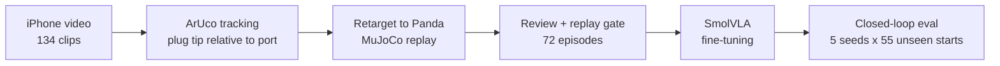

# MimicVLA: results

I recorded myself plugging a USB stick into a port with a handheld iPhone,
turned those clips into robot demonstrations in MuJoCo, and fine-tuned
SmolVLA on them. With **64 demonstrations whose tracking error is larger than
the port's clearance**, the Panda inserts the plug in **49% [39, 59]** of
rollouts from 55 start poses no model ever trained on, and 60% [52, 68] from
its training starts. Every number is a mean over 5 seeds per start with a
95% bootstrap interval.

Setup, commands and reproduction times are in the [README](README.md). More
detail is in two companion files: [data_collection.md](documentation/data_collection.md)
(recording, tracking problems and fixes) and
[experiments.md](documentation/experiments.md) (every run and table).

*Left to right: the iPhone recording with ArUco tracking, the Panda replaying
the human motion, and the policy from the same start. This recording never
entered training. The replay itself misses; the policy inserts in 2.7 s
(5/5 seeds).*

## Why USB insertion

I chose insertion because it is hard for a robot: the plug has to be aligned
to within a millimetre, pushed through contact, and corrected when it is
slightly off. A phone video provides none of that directly: no force, no robot
state, and a pose estimate noisier than the tolerance. The question was how
far a VLA gets from a small amount of such imperfect human data.

## 1. From a phone video to a robot demonstration

1. **Recording.** ArUco markers on the plug and next to the port, filmed with
   locked focus and exposure (Filmic Pro; the stock camera app refocuses and
   changes the calibration mid-clip). The plug pose is measured relative to
   the port marker, so the handheld camera's motion cancels.
2. **Tracking: from one plug marker to two.** With one marker, the hand or
   motion blur hid it exactly during the last centimetres before entry: the
   pose was missing in 30% of frames, with a median longest gap of 0.8 s.
   A second marker on another face of the plug raised coverage to 90% and
   cut the median longest gap to 7 frames (0.3 s). A second problem was
   offset drift: the marker-to-tip offset differed by 3.5–7.5 mm between
   sessions, so each session got its own fitted setup file. The remaining
   error is 1–3 mm. Details: [data_collection.md](documentation/data_collection.md).
3. **Replay.** The plug-tip trajectory drives the Panda's end effector through
   differential IK. Two simulated cameras (front and wrist), the joint state
   and the 6-D Cartesian action are recorded at 20 Hz. The policy never sees
   the phone video.
4. **Selection.** I reviewed every clip next to its replay (104 accepted). A
   replay is kept if the plug passes 7 mm deep during the human motion and
   finishes at least 12 mm deep. Contact with the port walls is allowed;
   only penetrating them by more than 1 mm (a simulator artefact) or hitting
   a joint limit rejects a replay. 72 episodes pass: 64 for training, 8 held
   out.

### The port is widened

The real port is 13.4 × 5.9 mm and the plug 12 × 4.5 mm: 0.7 mm of clearance
per side, less than the tracking error. Replayed into the real port, only 44
accepted clips insert, because the measurement is off, not because I missed.
I replayed the accepted clips into 46 port sizes:

| Opening | Clips that insert | Over 100 N peak force |
|---|---:|---:|
| 18 × 10 mm | 103 | 51 |
| 16 × 8 mm | 89 | 49 |
| **15 × 7 mm (chosen)** | **75** | 44 |
| 14 × 7 mm | 70 | 47 |
| 13.4 × 5.9 mm (real) | 44 | 34 |

Hugging Face recommends about 50 episodes to fine-tune SmolVLA. I aimed for
at least 70, to leave a holdout and because the data was already scarce, and
chose the smallest opening that keeps that many with some margin.
**All results use the 15 × 7 mm port.** It is easier than the real task (see
[Limitations](#6-limitations)). Success means the plug-tip centre is inside
the opening and at least 12 mm deep within 20 s.

## 2. How the policies are evaluated

My first comparisons used one rollout per start, and they were misleading:
across five evaluations of similar policies, 26 of 72 starts flipped between
success and failure. The final protocol:

- **5 seeds per start**, because SmolVLA samples its actions from noise.
- **95% bootstrap intervals over starts**, and paired differences when two
  policies run from the same starts.
- **55 unseen starts** as the main test: the start poses of recordings that
  never entered training (32 failed the replay gate, 7 were rejected in
  review, 16 were never reviewed). Only the start pose is used. The 8-clip
  holdout is too small to rank policies (intervals about 60 points wide).
- Deep collisions (over 1 mm into the port walls) and peak contact force are
  reported next to success.

## 3. Final results

| Policy | Training starts (64) | Unseen starts (55) | Deep-collision rollouts (55) | Median peak force (55) |
|---|---|---|---|---|
| **raw labels** | 60% [52, 68] | 49% [39, 59] | **4%** | 218 N |
| raw labels + recovery data | 55% [48, 61] | 51% [44, 56] | 14% | 213 N |
| 2 Hz low-pass labels | **82%** [74, 89] | 34% [23, 46] | 61% | 415 N |
| low-pass labels + recovery data | 66% [57, 75] | **52%** [43, 62] | 44% | 216 N |

- **Raw labels:** actions computed directly from the tracked poses.
- **Low-pass labels:** the tracked poses are smoothed at 2 Hz before
  retargeting (step 2 below).
- **Recovery data:** extra copies of each demonstration that start slightly
  off the human path and are labelled with a correction back to it (step 3).

All are SmolVLA (`lerobot/smolvla_base`) fine-tuned with batch 32. **I would
ship the simplest policy: raw labels, no augmentation.** It is within noise of
the best on unseen starts and collides least.

**Why 10k steps beat 20k for raw labels.** The raw-label run was evaluated at
both checkpoints, and 10k was better on every start set (unseen 49% vs 43%).
With only about 7,300 training frames, 10k steps at batch 32 is 44 passes
over the data and 20k is 88. My hypothesis is that the longer run memorises
the exact demonstrated states, including their jitter, and becomes more
brittle once a rollout leaves them, which happens early even from a training
start. I did not measure a held-out loss to confirm it. The low-pass policies
use their 20k checkpoint.

## 4. What I tried, in order

Each step responded to the failures of the previous one. Full tables are in
[experiments.md](documentation/experiments.md).

### Step 1: batch size

I started with batch size 1 because I did not know how much GPU memory
SmolVLA fine-tuning would need on a 16 GB card. That policy (30k steps)
succeeded on only 32% of its own training starts and had learned only the
forward approach, not the lateral and rotational corrections. Once I saw the
GPU had room, I raised the batch to 32, which fixed it (60%).

### Step 2: smoothing the labels — the best-looking model generalised worst

Failed rollouts drifted away from the port. The tracked poses are jittery
(72% of the tip's angular-velocity power is above 5 Hz, where deliberate hand
motion does not reach), so I low-pass filtered them at 2 Hz before
retargeting, to give the policy cleaner actions to imitate.

On its training starts, this model is the best by 20 points. On unseen starts
it is **15 points worse** than raw labels [4, 26], collides deeply in 61% of
rollouts, and pushes at over 400 N.

*Same start as at the top. Low-pass (bottom left) fails on 0/5 seeds; raw
labels (bottom right) insert on 5/5.*

Why, as I understand it:

- **The jitter was useful.** Raw tracking jitters from frame to frame, so
  raw demonstrations contain many states slightly off the smooth path,
  each paired with an action that comes back. This works like noise
  injection during data collection. Smoothing removes it: every
  demonstration becomes one clean path, so the policy has never seen a state
  next to the path. From a new start it is off-distribution at once and does
  not know how to recover.
- **Why the force rises.** The low-pass failures are not wild: they end
  tilted only 14–17° (raw: 28–50°) but laterally off the opening. The policy
  confidently replays the approach-and-push motion it learned, without the
  small corrections it never saw, and ends up pushing on the port face.
- **A confound:** filtering broke 17 clips (they stall on the rim), so the
  low-pass model trained on 49 demonstrations instead of 64. Step 6 shows how
  much 15 demonstrations matter, so part of the drop is less data.

Without the 55 unseen starts I would have submitted this model; the 8-clip
holdout could not tell the two apart.

### Step 3: recovery data — it works once the labels are human-scale

If the missing ingredient is off-path states, I can add them explicitly
(DART-style). Each training clip is re-executed three more times with a
smooth random offset of about 3 mm and 2° added to the command, and each
frame is labelled with a correction back towards the human path. Every label
still comes from a human motion.

- **Version 1 removed the whole offset in one step.** Success fell from 60% to
  25%: the rotation labels were almost twice as large as human ones, so the
  policy learned abrupt corrections and overshot.
- **Version 2 removes 15% of the offset per step**, which matches the human
  label statistics. On the low-pass model it recovers what smoothing lost:
  **+18 points on unseen starts [7, 30]**, force halves (415 → 216 N), deep
  collisions drop from 61% to 44%. On raw labels it changes nothing
  measurable (+1.5 points [−9, +12]).

This supports the explanation in step 2: recovery data and raw jitter supply
the same thing, so adding one to the other gives nothing. Three of the four
label × recovery combinations land at 49–52% on unseen starts. Processing the
labels differently moves the result by a few points at most; the ceiling is
set by something else.

### Step 4: RL on the noise (DSRL) — no gain

To improve the policy without breaking what it learned from humans, I tried
DSRL (Wagenmaker et al., 2025): SmolVLA stays frozen, and a small SAC policy
chooses the initial flow-matching noise for each action chunk, so every
action is still produced by the human-trained model. The reward is depth
progress plus a success bonus, minus force above 50 N, deep collisions and
time. Two runs (30k and 60k decisions) on the low-pass model, training starts
only.

It gained +0.6 points [−4.4, +5.3], and fixing the noise to zero did just as
well. The base policy's failures are systematic (it goes to the wrong place
whatever the noise), so choosing among its own behaviours cannot fix them.
RL would have to change the weights.

### Step 5: mirror augmentation — no gain

Flipping images is invalid here: the cameras are not symmetric about the
port, and a mirrored joint state is not a valid Panda state. Instead I
mirrored the human trajectories across the port's vertical mid-plane and
replayed them, which gives physically valid demonstrations. 48 of 72 still
insert. Adding the 46 training mirrors cost 9 points on unseen starts
[−18, +1] and raised deep collisions from 4% to 17%. Two explanations fit:

- **Too few steps for more data.** With 110 episodes and the same 10k steps,
  each original clip is seen 40% less often, and training-start success also
  fell (60% → 47%), which looks like underfitting.
- **The mirrored data is not useful.** One person's starts may not be
  symmetric about the port, so the mirrored half is spent where tests rarely
  start. If the mirrors were useful, they should have helped even at 10k
  steps, which they did not.

A 20k-step mirror run separates the two, and it is the next run I would
train. Mirroring is a cheap form of synthetic data, so it is worth settling
before recording more.

### Step 6: more human data — the strongest lever

| Demonstrations | Unseen starts (55) | Deep-collision rollouts |
|---|---|---|
| 16 | 16% [9, 24] | 75% |
| 32 | 24% [16, 32] | 21% |
| 64 | 49% [39, 59] | 4% |

Same recipe, nested subsets. Going from 32 to 64 demonstrations added 25
points [15, 36], more than 16 → 32. The gap between training and unseen
starts shrinks from about 30 points at 16 demonstrations to about 10 at 64,
and deep collisions almost disappear.

**This is the main conclusion.** Every method above changed unseen-start
success by a few points at most; doubling the data added 25, and the curve
has not flattened. The policy is data-limited, and getting much further
probably needs several times more demonstrations. That is good news for
this pipeline: each clip takes seconds to film, and its cost is the
tracking quality, not the quantity.

### Step 7: inference — re-planning and denoising steps

A VLA is large (SmolVLA: 450M parameters), and on a real arm it has to keep
up with the control loop, especially in contact, where corrections must be
fast. So I measured whether speed limits this policy and what it costs to
make it faster.

- **Latency fits with room to spare.** One 50-action chunk takes 114 ms on an
  RTX 5060 Ti with the default 10 denoising steps (about 28 ms for the
  vision-language model plus 8.6 ms per step). The policy executes 10 actions
  at 20 Hz per chunk, a 500 ms budget. Even a loaded CPU (324 ms) fits, so
  this policy would not need a large onboard GPU.
- **Fewer steps are not free.** 5 steps (71 ms) is within noise of 10, but
  1 step (37 ms) loses 17 points on training starts [10, 24] and nearly
  doubles deep collisions.
  In contact, the sample quality of the action matters, not just its speed.
- **Re-planning more often did not help.** Executing 2 instead of 10 actions
  per chunk gave a small, inconsistent gain and always more collisions,
  because consecutive chunks are independent samples and switching between
  them makes contact jerky.

So speed is not the bottleneck: the headroom could go to re-planning more
often (with smoothing between chunks) or to cheaper hardware, but neither
fixes where the policy goes wrong.

## 5. Conclusions

- **Data quantity dominates.** From 64 imperfect demonstrations a VLA reaches
  about 50% on unseen starts, and doubling the data was worth more than every
  algorithmic change combined.
- **Noise in human data can be a feature.** Tracking jitter acted as free
  recovery data; removing it made the policy fit better and generalise worse.
- **Evaluation decides the conclusion.** A single seed or an 8-clip holdout
  would have picked the wrong model. Multi-seed evaluation on unseen starts
  was the most important engineering choice of the project.

## 6. Limitations

- **Real to sim.** The human motion is measured with 1–3 mm error, so the
  port is widened to 15 × 7 mm, and the plug is rigidly attached to the hand
  (no grasp). The human corrected using force and touch, which the robot
  replay cannot reproduce: it re-executes the positions only. The simulated
  contact was not identified against the real port.
- **Sim to real.** No policy ran on hardware. Training images are rendered
  with fixed lighting and no randomisation, so nothing here tests visual
  transfer. Contact forces are too high for real hardware (median peaks
  around 200 N); force is neither observed nor penalised during training.
- **Scope.** One person, one port pose. The unseen starts test new start
  poses, not new scenes.

## 7. Next steps

1. **Train the mirror run for 20k steps.** It is the cheapest way to get
   more data, and it tells whether synthetic mirrored demonstrations help.
2. **Record more demonstrations**, with two markers on a rigid mount from the
   start. It is the only change that moved unseen success by more than
   noise, and it has not saturated.
3. **Add force.** Observe wrist force, penalise sustained high force, and
   fine-tune the weights with RL rather than only the noise.
4. **Shrink the port** towards the real size as an RL curriculum.
5. **Use a world model as the evaluator.** Trustworthy evaluation was the
   scarce resource here; a learned model that ranks policies like the
   55-start test would make iteration much cheaper.
