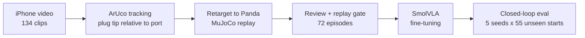

# MimicVLA: results

I recorded myself plugging a USB stick into a port with a handheld iPhone,
turned those clips into robot demonstrations in MuJoCo, and fine-tuned
SmolVLA on them. With **64 demonstrations whose tracking error is larger than
the port's clearance**, the Panda inserts the plug in **49% [39, 59]** of
rollouts from 55 start poses no model ever trained on, and 60% [52, 68] from
its training starts. Every number is a mean over 5 seeds per start with a
95% bootstrap interval.

Setup and commands are in the [README](README.md). Full tables, every run
and the development history are in
[documentation/experiments.md](documentation/experiments.md).

*Left to right: the iPhone recording with ArUco tracking, the Panda replaying
the human motion, and the policy from the same start. This recording never
entered training. The replay itself misses; the policy inserts in 2.7 s
(5/5 seeds).*

## Why USB insertion

I chose insertion because it is hard for a robot: the plug has to be aligned
to within a millimetre, pushed through contact, and corrected when it is
slightly off. A phone video provides none of that directly: no force, no robot
state, and a pose estimate noisier than the tolerance. The question was how
far a VLA gets from a small amount of such imperfect human data.

## 1. From a phone video to a robot demonstration

1. **Tracking.** ArUco markers sit on the plug and next to the port, and the
   phone is calibrated with a ChArUco board. The plug pose is measured
   relative to the port marker, so the handheld camera's motion cancels. Each
   recording session has a setup file with its marker transforms; I fitted
   the marker-to-tip offset per session because it drifted between sessions.
   The remaining error is 1–3 mm (90th percentile).
2. **Replay.** The plug-tip trajectory drives the Panda's end effector through
   differential IK. Two simulated cameras (front and wrist), the joint state
   and the 6-D Cartesian action are recorded at 20 Hz. The policy never sees
   the phone video.
3. **Selection.** I reviewed every clip next to its replay (104 accepted). A
   replay is kept if the plug passes 7 mm deep during the human motion,
   finishes at least 12 mm deep, and never penetrates the port walls or hits
   a joint limit. 72 episodes pass: 64 for training, 8 held out.

### The port is widened

The real port is 13.4 × 5.9 mm and the plug 12 × 4.5 mm: 0.7 mm of clearance
per side, less than the tracking error. Replayed into the real port, only 44
accepted clips insert, because the measurement is off, not because I missed.
I replayed the accepted clips into 46 port sizes:

| Opening | Clips that insert | Over 100 N peak force |
|---|---:|---:|
| 18 × 10 mm | 103 | 51 |
| 16 × 8 mm | 89 | 49 |
| **15 × 7 mm (chosen)** | **75** | 44 |
| 14 × 7 mm | 70 | 47 |
| 13.4 × 5.9 mm (real) | 44 | 34 |

15 × 7 mm is the smallest opening that keeps over 70 clips with some margin.
**All results use this port.** It is easier than the real task; see
[Limitations](#5-limitations). Success means the plug-tip centre is inside
the opening and at least 12 mm deep within 20 s.

## 2. How the policies are evaluated

My first comparisons used one rollout per start, and they were misleading:
across five evaluations of similar policies, 26 of 72 starts flipped between
success and failure. The final protocol:

- **5 seeds per start**, because SmolVLA samples flow-matching noise.
- **95% bootstrap intervals over starts**, and paired differences when two
  policies run from the same starts.
- **55 unseen starts** as the main test: the start poses of recordings that
  never entered training (32 failed the replay gate, 7 were rejected in
  review, 16 were never reviewed). Only the start pose is used. The 8-clip
  holdout is too small to rank policies (intervals about 60 points wide).
- Deep collisions (over 1 mm into the port walls) and peak contact force are
  reported next to success.

## 3. Results

| Policy | Training starts (64) | Unseen starts (55) | Deep-collision rollouts (55) | Median peak force (55) |
|---|---|---|---|---|
| **raw labels** | 60% [52, 68] | 49% [39, 59] | **4%** | 218 N |
| raw labels + recovery data | 55% [48, 61] | 51% [44, 56] | 14% | 213 N |
| 2 Hz low-pass labels | **82%** [74, 89] | 34% [23, 46] | 61% | 415 N |
| low-pass labels + recovery data | 66% [57, 75] | **52%** [43, 62] | 44% | 216 N |

SmolVLA (`lerobot/smolvla_base`), batch 32. Raw-label policies use the 10k-step
checkpoint, which beat 20k on every start set; low-pass policies use 20k.

**I would ship the simplest policy: raw labels, no augmentation.** It is
within noise of the best on unseen starts and collides least.

### Finding 1: the best-looking model generalised worst

Marker tracking is jittery (72% of the tip's angular-velocity power is above
5 Hz), so I low-pass filtered the tracked poses at 2 Hz. On its training
starts that model is the best by 20 points. On unseen starts it is **15
points worse** than raw labels [4, 26], collides deeply in 61% of rollouts and
pushes at over 400 N. Smooth labels are easy to imitate, but they remove the
small off-trajectory states and corrections the jitter contains, so from a
new start the policy drifts and does not recover.

*Same start as above. Low-pass (bottom left) fails on 0/5 seeds; raw labels
(bottom right) insert on 5/5.*

Without the 55 unseen starts I would have submitted this model.

### Finding 2: recovery data helps once the labels are gentle

Failed rollouts end centimetres from the port, the classic behaviour-cloning
drift. I generated DART-style recovery data: each clip re-executed with a
small random offset (about 3 mm, 2°), labelled with a correction back to the
human trajectory.

- **Version 1 removed the whole offset in one step** and dropped success from
  60% to 25%: the labels became large and abrupt, and the policy overshot.
- **Version 2 removes 15% per step**, matching the human label statistics. It
  repairs the low-pass model (+18 points [7, 30]) and halves its force, but
  adds nothing to raw labels, whose jitter already provides that variation.

### Finding 3: more human data is the strongest lever

| Demonstrations | Unseen starts (55) | Deep-collision rollouts |
|---|---|---|
| 16 | 16% [9, 24] | 75% |
| 32 | 24% [16, 32] | 21% |
| 64 | 49% [39, 59] | 4% |

64 vs 32 is +25 points [15, 36], more than 16 → 32. The gap between training
and unseen starts shrinks from about 30 points at 16 demonstrations to about
10 at 64. The curve has not flattened.

### Finding 4: inference speed is not the bottleneck

One 50-action chunk takes 114 ms on an RTX 5060 Ti with the default 10
denoising steps, against a 500 ms budget (10 actions at 20 Hz). 5 steps
(71 ms) is within noise of 10; 1 step (37 ms) costs 17 points.

## 4. What did not work

- **DSRL** (SAC choosing SmolVLA's initial noise, base model frozen): +0.6
  points [−4.4, +5.3], no more than fixing the noise to zero. The base
  policy's errors are systematic, not unlucky noise draws.
- **Mirror augmentation.** Flipping images is invalid (the cameras are not
  symmetric and a mirrored joint state is not a Panda state), so I mirrored
  the human trajectories across the port and replayed them. Adding these 46
  episodes cost 9 points [−18, +1] on unseen starts; a longer run might
  recover it, but I did not run one.
- **Batch size 1** learned only the forward approach (32% on its own
  training starts). Batch 32 fixed it.
- **Re-planning every 2 instead of 10 actions** gave a small, inconsistent
  gain and always more collisions.

## 5. Limitations

- **Simulation only**, with rendered images: nothing here tests sim-to-real.
- **The port is widened** to 15 × 7 mm, and the plug is rigidly attached to
  the hand (no grasp).
- **Contact forces are too high** (median peaks around 200 N). Force is
  neither observed nor penalised.
- **One person, one port pose.** The unseen starts test new start poses, not
  new scenes.

## 6. Next steps

1. **Record more demonstrations.** It is the only change that moved unseen
   success by more than noise, and it has not saturated.
2. **Add force.** Observe wrist force, penalise sustained high force, and
   fine-tune with RL on the actions rather than the noise.
3. **Shrink the port** towards the real size as an RL curriculum.
4. **Use a world model as the evaluator.** Trustworthy evaluation was the
   scarce resource here; a learned model that ranks policies like the
   55-start test would make iteration much cheaper.
