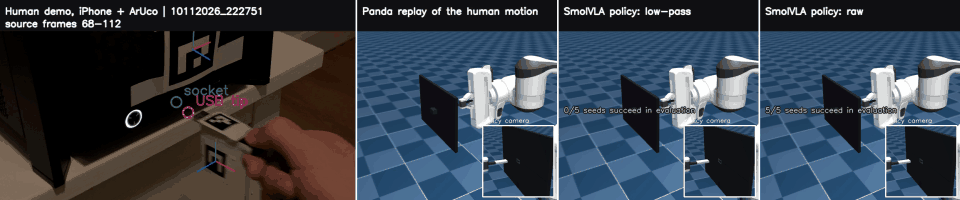
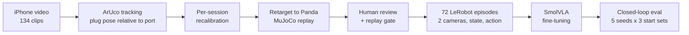
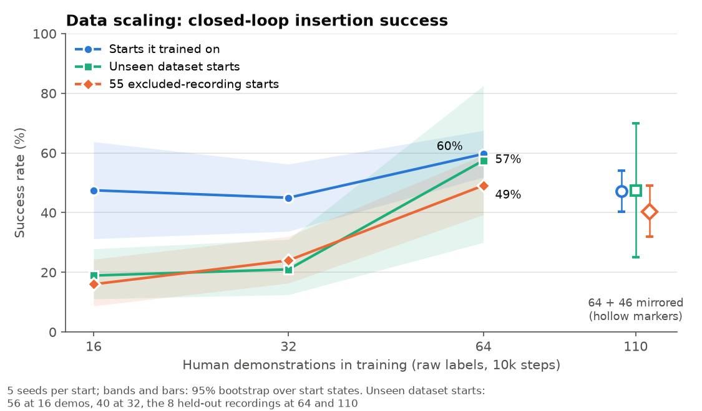

# MimicVLA: results

I recorded myself plugging a USB stick into a port with a handheld iPhone,
turned those clips into robot demonstrations, and fine-tuned SmolVLA on them.
In MuJoCo, the Panda now inserts the plug about **half the time from start
poses that no model ever trained on**, using 64 demonstrations whose tracking
noise is larger than the port's clearance.

This page explains how that number was obtained, why I trust it, and which
of the things I tried did not work. Setup and commands are in the
[README](README.md); full tables are in
[documentation/experiments.md](documentation/experiments.md).

*Left to right: the iPhone recording with ArUco tracking; the Panda replaying
the retargeted human motion; two SmolVLA policies from the same start. This
start comes from a recording that never entered training. The replay itself
misses, the low-pass-label policy fails (0/5 seeds), and the raw-label policy
inserts in 2.7 s (5/5 seeds).*

## Why USB insertion

Insertion is where imitation learning is weakest. The robot has to align to
millimetres, push through contact, and correct itself when it is slightly
off. A phone video gives none of this directly: no force, no robot state, and
a pose estimate that is noisier than the tolerance. I wanted a task where the
gap between human data and robot behaviour is visible, rather than one that a
replay alone could solve.

## 1. From a phone video to a robot demonstration

1. **Recording.** 134 clips of one person inserting a USB stick, filmed on a
   handheld iPhone. ArUco markers sit on the plug (one, later two) and next to
   the port. The phone may move: the USB pose is measured relative to the port
   marker, so the camera pose cancels.
2. **Tracking.** A ChArUco-calibrated camera, per-frame marker poses, and a
   mount prior that resolves the planar-marker orientation ambiguity. Gaps
   longer than four frames are left as gaps, not filled.
3. **Recalibration.** The marker-to-tip offset drifted between recording
   sessions, either because a mount moved or because of tracking bias; the
   data cannot tell which. I fitted an effective offset per session from the
   frames where the plug is known to be inside the port. Held-out radial error is
   still 1–3 mm (90th percentile).
4. **Retargeting and replay.** The tracked plug-tip trajectory, expressed in
   the socket frame, drives the Panda end effector through differential IK
   in MuJoCo. Two simulated cameras (fixed front and wrist) record RGB, joint
   state and the 6-D Cartesian action at 20 Hz. The policy never sees the
   phone video or the markers.
5. **Review and selection.** A local dashboard shows each original video
   next to its robot replay. 103 accepted clips went on to
   selection; the rest were rejected, held, or never reviewed.

### The tolerance problem

The real port is 13.4 × 5.9 mm and the plug 12 × 4.5 mm: 0.7 mm of clearance
per side, against 1–3 mm of tracking error. Replayed into that port, only 44
of the 103 accepted clips insert. They fail because the measurement is
off, not because the human missed.

I widened the simulated port rather than discard most of the data. A sweep
over 46 opening sizes ([details](documentation/pipeline.md#port-size)) picked
**15 × 7 mm without a funnel**: the smallest balanced size that keeps at
least 70 clips. 72 clips replay completely and cleanly into it. This is the
training set. **All results below use this widened port.** It is easier than
the real task, and I report it as a limitation, not a detail.

Success means the plug-tip centre is inside the opening and at least 12 mm
deep (the measured physical insertion depth) within 20 s.

## 2. How the policies are evaluated

My first comparisons used one rollout per start and an 8-clip holdout. They
were misleading. Across five evaluations of similar policies, 26 of 72 starts
flipped between success and failure, and one holdout rollout moves the rate
by 12.5 points. So the final protocol is:

- **5 seeds per start state.** SmolVLA samples flow-matching noise, so each
  rollout is one draw. A start's score is its mean over seeds.
- **95% bootstrap intervals over start states**, and paired differences when
  two policies run from the same starts.
- **Three start sets.** The 64 training clips; the 8 holdout clips; and
  **55 excluded starts**, the start poses of recordings that never entered any
  training set (they failed the replay check, were rejected in review, or were
  never reviewed). Only their start pose is used, so their tracking quality
  after the start does not matter. **This set is the main test of
  generalisation.**
- Deep collisions (more than 1 mm penetration into the port walls) and peak
  contact force are reported next to success.

## 3. Results

| Policy | Training starts (64) | Excluded starts (55) | Deep-collision rollouts (55) | Median peak force (55) |
|---|---|---|---|---|
| raw labels | 60% [52, 68] | 49% [39, 59] | **4%** | 218 N |
| raw labels + gentle recovery data | 55% [48, 61] | 51% [44, 56] | 14% | 213 N |
| 2 Hz low-pass labels | **82%** [74, 89] | 34% [23, 46] | 61% | 415 N |
| low-pass labels + gentle recovery data | 66% [57, 75] | **52%** [43, 62] | 44% | 216 N |

SmolVLA (`lerobot/smolvla_base`), batch 32, 10k steps for raw labels and 20k
for low-pass. 5 seeds per start.

**The policy I would choose is the simplest one: raw labels, no
augmentation.** It is within noise of the best on unseen starts and collides
least.

### Finding 1: the obvious winner was the wrong model

Raw marker tracking is jittery: 72% of the tip's angular-velocity power is
above 5 Hz, where deliberate hand motion does not reach. Low-pass filtering
the tracked poses at 2 Hz before retargeting looked like a clear improvement.
On the dataset starts it is the best policy by 20 points.

The excluded starts reversed the ranking. From poses it never trained on, the
low-pass model is **15 points worse** than raw labels (paired difference
[4, 26]), collides deeply in 61% of rollouts and pushes on the port face at over
400 N. Smooth labels make the demonstrations easy to imitate, so the model
fits its own starts very well. It never sees the small off-trajectory states
and corrections that the raw jitter contains, so from a new start it drifts
and does not recover.

Without the 55-start test set I would have submitted this model. The 8-clip
holdout could not separate the two: its intervals span about 60 points.

### Finding 2: recovery data works, after fixing the labels

The failures look like classic behaviour-cloning drift: failed rollouts end
centimetres from the port, not just next to it. So I generated DART-style
recovery data: each training clip is re-executed with a smooth random
offset (about 3 mm, 2°) injected into the command, and each frame is labelled
with a correction back towards the human trajectory. Every label still comes
from a human motion.

- **Version 1 made things much worse** (60% → 25% success). Each label
  removed the whole offset in one step, so rotation labels became large and
  abrupt, and the policy learned to overshoot.
- **Version 2 removes 15% of the offset per step.** The label statistics then
  match the human data. It repairs the low-pass model on unseen starts
  (+18 points [+7, +30]) and halves its contact force. It does nothing
  measurable for raw labels, whose jitter already provides the same
  off-trajectory variation.

Three of the four label × recovery combinations end up at 49–52% on excluded
starts. The one that does not is the over-smoothed model with no recovery.

### Finding 3: more human data is the strongest lever

Raw labels, same recipe, nested subsets of the training clips:

| Demonstrations | Excluded starts (55) | Deep-collision rollouts |
|---|---|---|
| 16 | 16% [9, 24] | 75% |
| 32 | 24% [16, 32] | 21% |
| 64 | 49% [39, 59] | 4% |

64 vs 32 is +25 points [+15, +36], a larger gain than 16 → 32. With 16 or 32
demonstrations the policy reproduces about half of its own starts but only
a fifth of new ones. At 64, training-start and unseen-start success nearly
meet. The curve has not flattened, so the next thing to do is record more
demonstrations.

### Finding 4: inference speed is not the bottleneck

On an RTX 5060 Ti, one 50-action chunk takes **114 ms** with the default 10
flow-matching steps. The policy executes 10 actions per chunk at 20 Hz, which
gives a 500 ms budget. Reducing to 5 steps (71 ms) is within noise of 10;
1 step (37 ms) costs 17 points [10, 24] and nearly doubles deep collisions.

## 4. What did not work

- **DSRL (RL over the diffusion noise).** I kept SmolVLA frozen and trained
  SAC to choose the initial flow-matching noise for each chunk, on training
  starts only (two runs, up to 60k decisions). It gained nothing beyond what
  a fixed all-zero noise gives (+0.6 points [−4.4, +5.3]). The base policy's
  errors are systematic, not unlucky noise draws, and noise steering cannot
  change where the model fails.
- **Mirror augmentation.** Flipping images is invalid here: the cameras are
  not symmetric about the port, and a flipped Panda joint state is not a
  Panda joint state. Instead I mirrored the human trajectories across the
  port's mid-plane and re-retargeted them, which produces physically valid
  robot demonstrations. 48 of 72 still insert. Adding them lowered success on
  excluded starts by 9 points [−18, +1]. Either the fixed step budget
  underfit the larger set, or the mirrored starts lie where real starts do
  not. A longer run would tell these apart; I did not run it.
- **Batch size 1.** The first baseline (batch 1, 30k steps) succeeded on 32%
  of its *own* training starts and had learned only the forward approach.
  Batch 32 fixed it.
- **Re-planning more often.** Executing 2 instead of 10 actions per chunk
  gave a small, inconsistent gain and always raised collisions, because
  consecutive chunks are independent samples.

## 5. Limitations

- **Simulation only.** No policy ran on hardware. The training images are
  rendered, so this says nothing about visual sim-to-real transfer.
- **The port is widened** from 13.4 × 5.9 mm to 15 × 7 mm, and the plug is
  rigidly attached to the hand (no grasp).
- **Contact force is too high.** Median peaks of about 200 N would damage
  real hardware. Force is neither observed by the policy nor penalised.
- **One person, one port pose, one session layout.** The excluded starts test
  new start poses, not new scenes.
- **The 8-demonstration point** of the scaling curve and the longer mirror
  run were not run.

## 6. What I would do next

1. **Record more demonstrations.** It is the only lever that has moved
   unseen-start success by more than noise, and it has not saturated.
2. **Make force part of the problem.** Add wrist force to the observation and
   end episodes on sustained high force, then fine-tune with RL on the
   policy's actions rather than its noise. DSRL showed that steering the noise
   is not enough.
3. **Tighten the port step by step.** The simulator already interpolates
   between a guided training port and the strict one
   (`curriculum_socket(tightness)`), which suits an RL curriculum.
4. **Try a world model as the evaluator.** The scarce resource here was
   trustworthy evaluation. A learned dynamics model that ranks policies the
   same way as the 55-start test would make the loop much cheaper.

## Data

- Human recordings, tracking and per-clip labels:
  [`<HF_USER>/mimicvla-human-usb-raw`](https://huggingface.co/datasets/<HF_USER>/mimicvla-human-usb-raw)
- LeRobot training set (72 MuJoCo episodes, two cameras):
  [`<HF_USER>/mimicvla-panda-usb-15x7`](https://huggingface.co/datasets/<HF_USER>/mimicvla-panda-usb-15x7)
