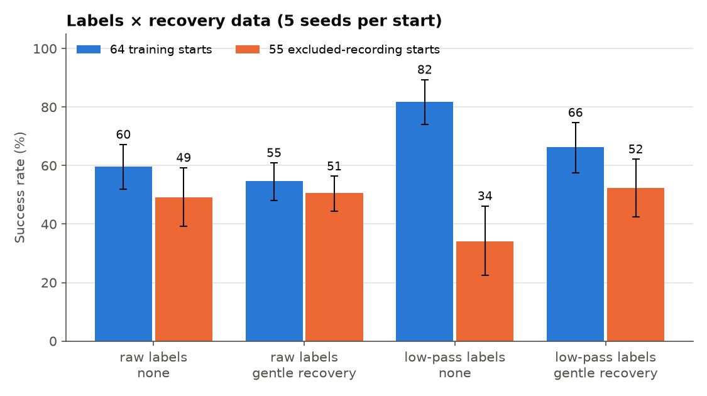
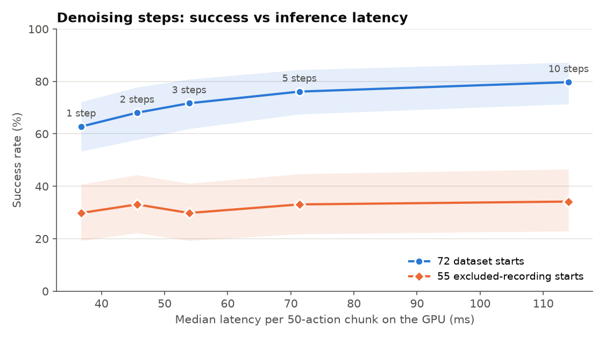

# Experiments

Everything behind [RESULTS.md](../RESULTS.md): the full tables of every
policy, the early diagnostics that led to the final protocol, and the
details of the data pipeline. Policy numbers are closed-loop MuJoCo
rollouts, not demonstration replays. Recording and tracking are covered in
[data_collection.md](data_collection.md).

## Protocol

`mimicvla.training.evaluate` starts each rollout from a recorded start state:
it replays that clip's simulator alignment prefix, then hands control to the
policy. A rollout succeeds when the USB tip centre is inside the
15 × 7 mm opening and at least 12 mm deep within 400 steps (20 s).
"Deep collision" means the simulator's `bad_collision` flag (more than 1 mm
penetration into the port walls) fired at least once. By default the policy
executes 10 of each 50-action chunk before re-planning (`--n-action-steps`).

Start sets:

- **Training starts (64)**: the clips of the 72-episode training set
  (`1clarkj/mimicvla-panda-usb`) used for training.
- **Holdout (8)**: clips of the same dataset that no model trained on
  (`mimicvla.dataset.splits`, seed 2026, stratified by recording session).
  Too few to rank models.
- **Excluded starts (55)**: aligned start poses from recordings that never
  entered any training set (32 accepted in review but failed the 15 × 7 mm
  replay gate, 7 rejected or held in review, 16 never reviewed). Only the
  start pose is used. **This is the main test of generalisation.**

Sections 1–5 use 5 seeds per start. A start's success is its mean over seeds;
intervals are 95% bootstraps over start states, and differences are paired
over the same starts. Section 6 records the earlier single-rollout
experiments that led to this protocol.

## Training runs

| Run | Labels | Train clips | Batch | Steps |
|---|---|---|---|---|
| `raw_10k`, `raw_20k` | raw tracked poses | 64 | 32 | 10k / 20k checkpoints of one run |
| `lowpass_20k` | 2 Hz low-pass tracked poses | 49 (17 clips no longer insert after filtering) | 32 | 20k |
| `recovery_v2_10k` | raw + gentle recovery copies (gain 0.15) | 64 | 32 | 10k |
| `lowpass_recovery_20k` | low-pass + gentle recovery copies | 49 | 32 | 20k |
| `raw_n16_10k`, `raw_n32_10k` | raw, nested subsets | 16 / 32 | 32 | 10k (full 10k LR schedule) |
| `raw_mirror_10k` | raw + mirrored trajectories | 110 | 32 | 10k (full 10k LR schedule) |
| `dsrl_v1`, `dsrl_v2` | frozen `lowpass_20k` + SAC noise actor | 64 | – | 30k / 60k decisions |

All start from `lerobot/smolvla_base` and use both cameras, the 9-D Panda
state and the 6-D Cartesian action.

## 1. Final comparison

Every policy ran 5 seeds from each start. The excluded starts are
`eval_starts/excluded55` in the published dataset.

| Policy | Training starts (64) | Holdout (8) | Excluded starts (55) | Deep-collision rollouts (64 / 55) | Median peak force (64 / 55) |
|---|---|---|---|---|---|
| `raw_10k` | 60% [52, 68] | 57% [30, 82] | 49% [39, 59] | 3% / 4% | 172 / 218 N |
| `raw_20k` | 55% [49, 62] | 55% [32, 78] | 43% [33, 52] | 6% / 4% | 197 / 281 N |
| `lowpass_20k` | 82% [74, 89] | 62% [25, 88] | 34% [23, 47] | 18% / 61% | 128 / 415 N |
| `lowpass_20k_zero_noise` | 81% [72, 89] | 60% [25, 88] | 33% [21, 45] | 19% / 64% | 128 / 417 N |
| `dsrl_v1` | 80% [70, 88] | 62% [25, 88] | 32% [21, 44] | 19% / 64% | 131 / 431 N |
| `dsrl_v2` | 82% [74, 90] | 62% [25, 88] | 35% [23, 47] | 18% / 61% | 121 / 439 N |
| `lowpass_recovery_20k` | 66% [58, 75] | 43% [18, 68] | 52% [42, 62] | 34% / 44% | 161 / 216 N |

Paired differences (same starts, 95% bootstrap interval):

- Low-pass vs raw 10k, dataset starts: **+20.3 pts** [+11.7, +28.9].
- Raw 10k vs low-pass, excluded starts: **+14.9 pts** [+4.0, +26.2].
- Low-pass + gentle recovery vs low-pass, excluded starts: **+18.2 pts** [+6.5, +29.5].
- DSRL v2 vs low-pass (random noise), dataset starts: +0.6 pts [-4.4, +5.3].

What these differences mean is discussed in [RESULTS.md](../RESULTS.md),
steps 2–4.

## 2. Data scaling

Raw labels, batch 32, 10k steps. **The learning-rate schedules are not
matched.** The 64-demo point is the 10k checkpoint of the 20k-step
`raw_bs32_20k` run, where the cosine schedule is halfway (learning rate about
51% of its peak). The 16- and 32-demo runs (and the mirror run, section 3)
were launched with a 20k decay horizon to match, but LeRobot rescales the
schedule when the step count is smaller than the decay horizon
("Auto-scaling LR scheduler … 20000 → 10000" in the training logs). They
therefore warmed up for 500 steps and decayed fully to the minimum learning
rate by step 10k. The same applies to `recovery_v2_10k` (section 4). The
smaller runs received the more complete schedule, which would favour them,
so the schedule is unlikely to explain the 25-point gain from 32 to 64
demonstrations, but a matched rerun is needed to rule it out.
`mimicvla.dataset.splits` draws nested subsets of the 64 training clips
(seed 2026): 16 ⊂ 32 ⊂ 64.

| Demos | Policy | Trained starts | Excluded starts (55) | Deep-collision rollouts (55) | Median peak force (55) |
|---|---|---|---|---|---|
| 16 | `raw_n16_10k` | 48% [31, 64] | 16% [9, 24] | 75% | 610 N |
| 32 | `raw_n32_10k` | 45% [34, 56] | 24% [16, 32] | 21% | 285 N |
| 64 | `raw_10k` | 60% [52, 68] | 49% [39, 59] | 4% | 218 N |
| 110 (64 + 46 mirrored) | `raw_mirror_10k` | 47% [40, 54] | 40% [32, 49] | 17% | 222 N |

Paired differences on the 55 excluded starts:

- 64 vs 32 demos: **+25.1 pts** [+14.9, +35.6].
- 64 vs 16 demos: **+33.1 pts** [+21.8, +44.0].
- 32 vs 16 demos: +8.0 pts [−0.4, +16.7].

Interpretation:

- **More human demonstrations help, and the curve has not flattened.** The
  gain from 32 to 64 is larger than from 16 to 32. Success on unseen starts
  roughly doubles and deep collisions drop from 75% to 4% of rollouts. The
  gap between trained and unseen starts shrinks from about 30 points at 16
  demos to about 10 at 64.
- **At 16 and 32 demos the policy memorises.** It reproduces about half of
  its own starts but only about a fifth of new ones.
- **The 8-demo point was not run.** Its training job ran out of GPU memory
  while three evaluations shared the GPU, and there was no time to restart it.
- The obvious next step is more recordings. Each one is a human trajectory,
  so this is the cheapest lever available.

## 3. Mirror augmentation: valid, but it did not help

**Why not flip images.** The scene is not left–right symmetric. The fixed
camera sits to one side of the port, and the wrist camera is mounted 45 mm to
one side of the plug. A flipped image is therefore a view that no camera in
the scene can produce. The 9-D joint-state observation cannot be mirrored
either, because a Panda configuration has no mirrored counterpart through a
simple sign flip. Image flipping would teach the policy inconsistent data.

**What was done instead.** `retarget.py` gained a `mirror_socket_x` option.
It reflects the tracked human trajectory across the port's vertical
mid-plane (p → Mp, R → MRM with M = diag(−1, 1, 1) in the socket frame,
which keeps rotations proper). The mirrored human motion is then
re-retargeted onto the Panda and re-rendered from the real cameras.
Every mirrored episode is a physically valid robot demonstration with correct
images, joint states and actions. It still comes from a human trajectory.

- `mimicvla build-dataset --mirror` → `usb_15x7_mirror`: 120 episodes,
  13,806 frames. Of 72 mirrored clips, **48 pass the same replay gate** as
  the originals. Almost all 24 rejects stall on the rim at about 0 mm depth,
  the same failure as low-pass breakage; the human's fine corrections are
  probably not symmetric about the opening.
- Mirrors of holdout clips stay in the holdout, so 110 episodes train
  (64 originals + 46 mirrors).
- Applied to raw labels, because they give the best policy without recovery
  data and keep all 72 clips (low-pass labels break 17).

**Result.** `raw_mirror_10k` is worse than `raw_10k`: −8.7 pts on excluded
starts [−18.2, +0.7] and −12.5 pts on training starts [−22.2, −3.1]. Deep
collisions on excluded starts rise from 4% to 17%.

Likely reasons, untested:

1. **Fixed step budget.** Both runs train for 10k steps, so with 110 episodes
   each original clip is seen about 40% less often. The training-start drop
   is consistent with underfitting.
2. **Mirrored starts may not match test starts.** If real start states
   cluster on one side of the port (one person, one approach habit), mirrored
   data spends capacity on the other side, which the excluded starts rarely
   visit. The start distribution has not been checked for this.

A 20k-step mirror run separates these and is the next run to train. If the
mirrors were useful, they should already have helped at 10k steps, so the
second reason is the more likely one, but only the longer run can show it.

**Lighting augmentation was skipped.** The simulator renders with fixed
lighting, so evaluation in sim cannot show a benefit. It belongs to
sim-to-real transfer, which this project does not test.

## 4. Labels × recovery data (2 × 2)



| Labels | Recovery data | Policy | Training starts (64) | Holdout (8) | Excluded starts (55) | Deep-collision rollouts (64 / 55) | Median peak force (64 / 55) |
|---|---|---|---|---|---|---|---|
| raw | none | `raw_10k` | 60% [52, 67] | 57% [30, 82] | 49% [39, 59] | 3% / 4% | 172 / 218 N |
| raw | gentle recovery | `recovery_v2_10k` | 55% [48, 61] | 48% [30, 68] | 51% [44, 56] | 16% / 14% | 189 / 213 N |
| low-pass | none | `lowpass_20k` | 82% [74, 89] | 62% [25, 88] | 34% [23, 46] | 18% / 61% | 128 / 415 N |
| low-pass | gentle recovery | `lowpass_recovery_20k` | 66% [57, 75] | 43% [18, 68] | 52% [43, 62] | 34% / 44% | 161 / 216 N |

Paired differences on the excluded starts: raw + recovery vs raw, +1.5 pts
[−9.1, +11.6]. Low-pass + recovery vs raw + recovery, +1.8 pts [−7.6, +11.6].
On the training starts, raw + recovery vs raw is −5.0 pts [−15.6, +5.9].

Interpretation:

- **Three of the four cells generalise equally well (49–52%).** Only
  low-pass labels without recovery fall to 34%.
- **The effects interact.** Recovery data repairs the low-pass model
  (+18 pts, section 1) but does nothing measurable for raw labels.
  The jitter in raw labels already shows the policy small off-trajectory
  states and corrections, and gentle recovery adds the same kind of
  variation. Low-pass labels remove it, and recovery data puts it back.
- **Low-pass labels trade generalisation for fit.** They give the best
  training-start success (82%) but cause the most force on new starts.
- **Caveat:** raw-label cells use the 10k checkpoint, low-pass cells 20k.
  For raw labels, 10k beat 20k on every start set (section 1). On the
  learning-rate schedule of the 10k runs, see section 2.

## 5. Denoising steps and inference latency



SmolVLA produces each 50-action chunk with flow matching, by default in
10 denoising steps. Fewer steps are faster but give a coarser sample.
`mimicvla.training.evaluate --num-steps N` changes this at inference only;
the model is `lowpass_20k`. Latency comes from `mimicvla.training.latency`
on an idle GPU: 20 real start observations × 3 repeats, with a CUDA
synchronisation around each call. Each call runs the full VLM prefix and
denoising, as at every re-plan.

| Denoising steps | Seeds | 72 dataset starts | 55 excluded starts | Median time to insert | Deep-collision rollouts (72) | Chunk latency, GPU (idle) | Chunk latency, CPU (loaded, upper bound) |
|---|---|---|---|---|---|---|---|
| 1 | 5 | 63% [53, 72] | 30% [19, 41] | 2.50 s | 37% | 37 ms | 161 ms |
| 2 | 5 | 68% [58, 78] | 33% [22, 44] | 2.50 s | 32% | 46 ms | – |
| 3 | 5 | 72% [62, 81] | 30% [19, 41] | 2.52 s | 28% | 54 ms | – |
| 5 | 5 | 76% [68, 84] | 33% [22, 45] | 2.58 s | 24% | 71 ms | – |
| 10 (default) | 5 | 80% [71, 87] | 34% [23, 47] | 2.65 s | 20% | 114 ms | 324 ms |

GPU, idle (RTX 5060 Ti, 16 GB): median 37 ms at 1 step and 114 ms at 10
steps, so each denoising step costs about 8.6 ms on top of about 28 ms for
the VLM prefix. CPU latency (5 observations, measured while four GPU
evaluations shared the CPU, so an upper bound): 161 ms at 1 step and 324 ms
at 10 steps.

Interpretation:

- **10 steps is affordable.** The policy executes 10 actions per chunk at
  20 Hz, which allows 500 ms per chunk. 10 steps uses 23% of that on this GPU
  and still fits on the CPU. If inference ran synchronously, a 114 ms call
  would stall the 50 ms control loop for about two ticks every 10. Running
  inference asynchronously, during the previous chunk, hides it.
- **1 step costs real success.** 1 vs 10 steps: −16.9 pts on dataset starts
  [−24.4, −10.0], and deep collisions rise from 20% to 37%. 5 steps is
  within noise of 10 (−3.6 pts [−7.8, +0.3]) at 62% of the latency.
  Success rises steadily with steps, so 5 is a trade-off, not a free saving.
- Time to insert barely changes (2.50–2.65 s), so fewer steps do not make the
  motion faster, only less accurate.
- On excluded starts every setting sits around 30–34%, the low-pass model's
  generalisation ceiling. Faster sampling does not change where the model
  fails.

## 6. Early diagnostics (single rollouts)

Before the final protocol, policies were evaluated with one rollout per start
on the 72 dataset starts. **The numbers in sections 1–5 supersede these.**
Single rollouts proved too noisy to rank policies: across five evaluations of
low-pass-based policies, 26 of the 72 starts flipped between success and
failure. The runs are kept for the diagnostics below, which explain the
choices behind the final runs.

### Batch size

The first policy trained with batch size 1 (about 3.7 passes over the data,
30k steps), because it was not yet clear how much GPU memory fine-tuning
would need; batch 32 turned out to fit in 16 GB. With batch 1 it succeeded on
23 of its own 72 training starts, with 18 deep collisions. An open-loop check
on training frames showed it had learned only the forward approach (R² 0.64
on the 10-step sum of dx); every lateral and rotational dimension scored
below zero, worse than predicting the mean. Batch 32 reached 40–43/72.

### Failures are drift, not near misses

No failed raw-label rollout ends near the port: none finishes within 10 mm
laterally. Failed rollouts end several centimetres away, tilted 28–50°.
Success and failure split early: either the policy tracks the approach, or
it drifts and keeps drifting, the compounding-error pattern of behaviour
cloning. This is what motivated the low-pass labels and the recovery data.

Low-pass failures look different: they end about 15 cm away but tilted only
14–17°, with higher peak force (about 500 N). Rotation drift is mostly gone,
and failures become lateral misses that end pushing on the port face.

### The first hint that low-pass labels overfit

With single rollouts, the low-pass model looked like the clear winner (55/72
against 40/72 for raw labels at 20k). Split by which clips each model trained
on, the gain was almost entirely on its own training clips:

| Start states (20k checkpoints) | Low-pass | Raw (re-plan 2) | Raw (re-plan 5) |
|---|---|---|---|
| 49 clips the low-pass model trained on | 41/49 | 35/49 | 29/49 |
| 15 clips the filter rejected (raw trained on them, low-pass did not) | 9/15 | 9/15 | 7/15 |
| 8 holdout clips (neither trained on them) | 5/8 | 5/8 | 4/8 |

On clips it never saw, the low-pass model only matched the raw one, even on
the 15 clips the raw model did train on. With 23 unseen starts this could not
be settled, which is why the 55 excluded starts were added (section 1).

### Re-planning more often

| Checkpoint | Re-plan every | Success | Deep collisions |
|---|---|---|---|
| raw 10k | 10 | 43/72 | 1 |
| raw 10k | 2 | 43/72 | 8 |
| raw 20k | 10 | 40/72 | 3 |
| raw 20k | 5 | 40/72 | 4 |
| raw 20k | 2 | 49/72 | 8 |

Re-planning every 2 steps gave +9 rollouts at 20k but nothing at 10k, and it
always raised deep collisions. Consecutive chunks are independent noise
samples, so frequent switching makes the motion jerkier at contact.
Ensembling overlapping chunks would avoid the switching. All final runs
re-plan every 10 steps.

### Why recovery data version 1 failed

Version 1 (gain 1.0) dropped success to 18/72 at 10k, against 43/72 for raw
labels; failed rollouts ended about 34 cm away and 89° off. Each label
removed the whole offset in one step (capped at 3 mm and 2°). With a 2° RMS
rotation offset the cap is hit often, so the rotation label spread rose from
7.3 to 12.7 mrad per step, and the policy learned large, abrupt rotations
that overshoot in closed loop. A second issue: the labels depend on the
controller's internal target, which the policy cannot observe, because the
arm lags the target.

Version 2 removes 15% of the offset per step (`--correction-gain 0.15`). On
5 sample clips this brings the label spread back to human scale (7.0–7.7 mrad
and 1.0–1.2 mm per step, against 7.3 mrad and 0.8–1.3 mm for raw labels), and
the arm returns to the human path over about 0.3 s. Its 5-seed results are in
section 4.

## Data pipeline details

Recording and tracking problems are in [data_collection.md](data_collection.md).

### Retargeting and simulation

`mimicvla.retarget` turns the tracked `T_socket_usb_tip` segment into robot
commands: it resamples to 20 Hz, removes isolated pose outliers, lightly
smooths translation while keeping the final depth, and limits each Cartesian
target step to 3 mm and 2°. The targets are placed at the simulated socket,
and a short bridge from the reset pose to the first tracked pose is added
(the "alignment" that evaluation also replays to reach each start state).
Mink differential IK turns end-effector targets into joint targets, and the
Panda's position actuators track them.

| Item | Definition (`src/mimicvla/sim/env.py`) |
|---|---|
| Robot | MuJoCo Menagerie Panda; the USB plug (12 × 4.5 mm) is rigidly attached to the hand |
| Action | 6 floats at 20 Hz: world-frame `dx, dy, dz` (m) and a rotation vector (rad) applied to the end-effector target |
| State | 9 floats: seven joint angles (rad), two finger positions (m) |
| Cameras | `camera1` fixed front, `camera2` on the wrist; 256 × 256 RGB |
| Port | rectangular opening in a flush wall, 18 mm deep; 15 × 7 mm unless noted |
| Success | plug-tip centre inside the opening and at least 12 mm deep |
| Deep collision | more than 1 mm penetration into the port walls (wall contact itself is allowed) |

### Selection

1. **Review: 104 of 134 clips accepted.** Each clip was reviewed next to its
   replay into an 18 × 10 mm port; 5 were rejected, 2 held, 23 never
   reviewed.
2. **Port sweep: 75 clips.** The 103 accepted clips available at the time
   were replayed into 46 openings. In the 15 × 7 mm port, 75 reach 7 mm tip
   depth during the human motion without a deep collision or joint-limit
   fault.
3. **Full replay: 72 clips.** Checked to the end of the replay, two have late
   deep collisions and one ends shallower than 12 mm. The remaining 72 (36
   single-marker, 36 two-marker) are the training set; `mimicvla
   build-dataset` applies steps 2 and 3 in one pass.

Port sweep (a clip counts if it passes 7 mm deep during the human motion with
no deep collision or joint-limit fault up to that point):

| Opening | Clips | Area | Clips over 100 N peak |
|---|---:|---:|---:|
| 18 × 10 mm (review port) | 103 | 180 mm² | 51 |
| 16 × 8 mm | 89 | 128 mm² | 49 |
| 15 × 8 mm | 85 | 120 mm² | 50 |
| **15 × 7 mm (chosen)** | 75 | 105 mm² | 44 |
| 14 × 7 mm | 70 | 98 mm² | 47 |
| 17.4 × 5.1 mm | 70 | 89 mm² | 62 |
| 13.4 × 5.9 mm (real port) | 44 | 79 mm² | 34 |

17.4 × 5.1 mm is the smallest area with 70 clips, but it leaves 0.3 mm over
the plug height and 62 of its clips exceed 100 N. 14 × 7 mm has no margin
for later rejections. An earlier design with an entry funnel let more
replays insert but pushed the plug hard against the funnel, so it was
dropped.

Clips over 100 N peak force were kept; 100 N was a triage screen, not a
limit. Each episode's peak force is in `capture_manifest.json`.

The 8 held-out clips (`mimicvla.dataset.splits`, seed 2026) are stratified
by session: 4 of 36 single-marker, 3 of 32 two-marker, 1 of 4 first-mount.
The split is keyed by clip name, so every derived dataset holds out the same
demonstrations, mirrored copies included.

### Dataset variants

All are built from the same 72 clips by `scripts/reproduce_results.sh data`
and keep only episodes that pass the same replay gate.

| Dataset | Built with | Episodes | Frames | Change |
|---|---|---:|---:|---|
| `usb_15x7` (published as `mimicvla-panda-usb`) | `build-dataset` | 72 | 8,089 | raw tracked poses |
| `usb_15x7_lowpass2hz` | `build-dataset --lowpass-hz 2` | 55 | 4,768 | zero-phase 2nd-order Butterworth at 2 Hz on tip position and orientation |
| `usb_15x7_recovery` | `dataset.recovery --correction-gain 0.15` | 254 | 28,821 | 1 clean + 3 perturbed copies per training clip |
| `usb_15x7_lowpass2hz_recovery` | same, from the low-pass set | 185 | – | the same on low-pass labels |
| `usb_15x7_mirror` | `build-dataset --mirror` | 120 | 13,806 | 72 originals + 48 mirrored copies |

**Low-pass.** 72% of the tracked tip's angular-velocity power is at or above
5 Hz and 7% below 2 Hz, while deliberate hand motion lies below 2–3 Hz.
Filtering roughly halves per-step rotation jitter and changes net motion by
about 1 mm, but 17 clips then stall on the rim (0–1 mm deep, 5–12 mm off
centre). This leaves 55 episodes, 6 of them held out.

**Recovery.** Each training clip is re-executed four times: once clean and
three times with a smooth Ornstein–Uhlenbeck offset (about 3 mm and 2° RMS)
added to the executed command, fading to zero within 5 mm of the port. Each
frame is labelled with the command that moves the target back towards the
human trajectory, removing `--correction-gain` of the offset per step (1.0
in version 1, 0.15 in version 2). Held-out clips are not used. 254 of 256
copies pass the gate.

**Mirror.** Each tracked tip trajectory is reflected across the port's
vertical mid-plane (`mirror_socket_x` in `src/mimicvla/retarget.py`), then
retargeted and rendered like an original (section 3).

## Reproduce

`scripts/reproduce_results.sh` rebuilds the dataset variants, trains every
run and evaluates it, in order. Single steps:

```bash
bash scripts/train.sh RUN STEPS [DATASET] [BATCH]       # holdout clips excluded automatically
uv run mimicvla evaluate CKPT --seeds 0 1 2 3 4          # 55 excluded starts
uv run python -m mimicvla.training.report                # tables, intervals, figures
```

Lower-level options (`--n-action-steps`, `--num-steps`) are on
`python -m mimicvla.training.evaluate --help`.
