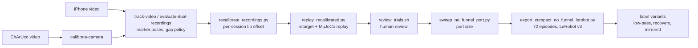

# Data pipeline: iPhone recording to LeRobot dataset

This page describes how a handheld iPhone video of a USB insertion becomes a
LeRobot training episode for the simulated Panda. Results and policy
comparisons are in [RESULTS.md](../RESULTS.md).

Commands write to `outputs/` and read videos from `video_data/`. Both are
generated or local and are not in the repository.

## Overview



The phone video is used only to measure motion. The policy never sees it.
Training images, Panda states and actions are all recorded together during
the MuJoCo replay, so they come from one embodiment and one camera setup.
Human video cannot supply Panda joint states, and pairing phone frames with
simulated actions would mix two viewpoints and two embodiments.

## Hardware and recording

| Item | Specification |
| --- | --- |
| USB marker 0 | ArUco `DICT_4X4_50` ID 0, 20 mm outer black square, on the plug |
| USB marker 10 | ID 10 cut from the ChArUco sheet, 22 mm, second marker on the plug |
| Port marker 1 | ID 1, 50 mm, fixed next to the port |
| Plug | 12 × 4.5 mm |
| Physical port | 13.4 × 5.9 mm opening, 12 mm measured insertion depth |

Printable sheets are in `calibration/`:

- [charuco_calibration_A4.pdf](../calibration/charuco_calibration_A4.pdf):
  5 × 7 squares, 30 mm squares, 22 mm markers, IDs 10–26, `DICT_4X4_50`.
- [aruco_USB_and_port_A4.pdf](../calibration/aruco_USB_and_port_A4.pdf):
  USB ID 0 at 12, 15, 18 and 20 mm, and port ID 1 at 50 mm. Use one USB
  marker and keep spare copies of IDs 0 and 1 out of the frame.

The first recordings used marker 0 alone; four used the 12 mm size and the
rest 20 mm. Marker 10 was added later to cover occlusions of marker 0. The
134 source clips fall into four batches:

| Batch (code name) | Clips | Markers on plug | Marker-0-to-tip translation |
| --- | ---: | --- | --- |
| Single marker, 20 mm (`single_20mm`) | 58 | 0 | `[0, +30, -3]` mm |
| Single marker, 12 mm (`single_12mm`) | 4 | 0 | `[0, +30, -3]` mm |
| Dual marker, earlier mount (`dual_minus3`) | 9 | 0 and 10 | `[-3, +30, -3]` mm |
| Dual marker, restored mount (`dual_original`) | 63 | 0 and 10 | `[0, +30, -3]` mm |

Phone settings and recording practice:

- Use the same lens, zoom, focus mode, resolution, orientation and
  stabilisation setting for calibration and demonstrations. Avoid automatic
  lens switching and digital stabilisation or cropping; they change the
  effective intrinsics.
- The phone may move. Keep the port marker and at least one plug marker
  visible together from 5–10 cm before the port until the plug is seated.
- Start and end with a short still hold. Avoid blur during entry; fast
  motion caused most missing detections.
- Vary the plug path relative to the port (lateral and angular offsets that
  are corrected before entry), not the phone viewpoint.
- If a video fails to decode, export it as plain H.264 MP4 without resizing
  or cropping.

## Camera calibration

Record a short video of the flat ChArUco board, moved and tilted across the
image, then run:

```bash
uv run mimicvla calibrate-camera --input calibration_video.mp4 \
  --output outputs/iphone_calibration.json --stride 15
```

A directory of photos also works as `--input`. The command needs at least six
useful views. It reports RMS reprojection error, board-centre coverage, and
the focal-length difference between the first and second halves of the
recording. A low RMS from similar views can still give unstable intrinsics, so
the coverage and split checks matter. The calibration used here is
3840 × 2160, 33 accepted views, 0.64 px RMS, and a 3.0% split focal-length
difference. Calibration and demonstration image sizes must match.

## Marker tracking

`mimicvla track-video` (single marker) and `mimicvla evaluate-dual-recordings`
(two markers) estimate each marker pose per frame with OpenCV.

Conventions:

- `T_A_B` maps points from frame B to frame A.
- Camera coordinates follow OpenCV: x right, y down, z forward.
- Marker +Z points out of the printed face.
- The tracked quantity is
  `T_port_usb = inverse(T_camera_port) @ T_camera_usb`. The camera pose
  cancels, so the phone may move.

Planar markers have two pose solutions with similar reprojection error. The
early tracker sometimes switched between them, which produced large false
rotations in fast clips. The tracker now chooses using temporal continuity and
a bounded orientation prior from the known marker mounts. Every detection
records `pose_selection`; the value `task_orientation_prior` means the mount
prior resolved the ambiguity. Each record also stores the reprojection error
and the error gap between the two solutions. A small gap means an uncertain
orientation.

With two plug markers, marker 10 is primary and marker 0 is the fallback. The
rigid marker-10-to-marker-0 transform is fitted per batch from co-visible
frames and saved as `usb_dual_mount.json`. A batch needs at least 20
co-visible frames. Do not reuse tracking or this fit across batches. Even
after the fit, the 95th percentile of co-visible marker disagreement is
5–17 mm per clip, so a replayable track does not imply millimetre accuracy.

Gap policy:

- Frames with a missing marker or high reprojection error get no pose. No
  pose is invented.
- Up to four missing frames are interpolated, and only when the neighbouring
  poses imply plausible motion. Losses of 1–2 s stay as gaps. The tracker
  resets its continuity state after more than four missing frames.
- Steps faster than 0.75 m/s or 8 rad/s split a segment.
- A segment is eligible for replay if it has at least 20 continuous frames,
  starts no more than 5 mm inside the port, reaches at least 6 mm depth, and
  makes at least 10 mm axial progress. The segment with the most progress is
  chosen. A segment that starts less than 5 mm before the mouth is flagged as
  a truncated approach. The 6 mm depth here is an eligibility gate, not task
  success.

Evidence clips (video only):

| Clip | Shows |
| --- | --- |
| [single_marker_tracking_gap.mp4](evidence/single_marker_tracking_gap.mp4) | Marker 0 lost for frames 34–51 of one clip; the 18-frame gap is left empty. |
| [single_marker_before_pose_prior.mp4](evidence/single_marker_before_pose_prior.mp4) | Pose ambiguity before the prior: 360 replay steps, joint-limit violations, 130 deep-collision steps. |
| [single_marker_after_pose_prior.mp4](evidence/single_marker_after_pose_prior.mp4) | Same clip with the prior: 95 steps, within joint limits, no deep collisions, 12 mm entry. |
| [dual_marker_visibility.mp4](evidence/dual_marker_visibility.mp4) | Marker 0 lost around frames 72–94 while marker 10 keeps tracking. Only the dual track gives a replayable segment. On the seven-clip pilot batch, dual tracking recovered 1,001 of 1,056 poses against 705 with marker 0 alone. |

## Marker-to-tip offsets and per-session recalibration

Two fixed offsets link the markers to the task:

- Port marker centre: `[+16, -45, 0]` mm in the socket frame. Port marker +Z
  points outward, opposite socket +Z.
- USB tip (centre of the plug's leading metal face) in the marker 0 frame:
  translation as in the batch table above. Marker +Z follows tip −Y, and tip
  +Z follows marker +Y. These rotations were inferred from a near-insertion
  frame, not measured.

`mimicvla inspect-marker-frames` projects the predicted tip and socket target
onto a video frame for checking (`--tip-x-mm` sets the X offset).

The measured offsets drifted between sessions. Every clip shows a physical
insertion, so `mimicvla.dataset.recalibrate` takes one median tracked tip
position per clip while it is 8–22 mm inside the nominal port. It then fits a
robust per-session correction to marker-frame X and Z. Y (30 mm, measured) and
all rotations stay fixed. A new session needs a sustained change over at least
five clips. Raw tracks are not modified.

| Batch / period | Clips used | X correction | Z correction | Leave-one-clip-out radial p90 |
| --- | ---: | ---: | ---: | ---: |
| Single 20 mm, early | 5 | −3.56 mm | −0.53 mm | 1.83 mm |
| Single 20 mm, later | 52 | −6.20 mm | −0.72 mm | 1.90 mm |
| Restored dual, first period | 42 | −4.61 mm | −0.51 mm | 1.82 mm |
| Restored dual, 223132–223207 | 5 | −7.28 mm | +2.41 mm | 1.19 mm |
| Restored dual, 223222–223334 | 9 | −3.83 mm | −1.16 mm | 0.97 mm |
| Restored dual, final period | 7 | −4.77 mm | +1.00 mm | 3.22 mm |
| Earlier dual mount | 9 | −6.29 mm | −0.35 mm | 1.72 mm |

Caveats:

- The port marker mount is held fixed, so this is an effective task-relative
  offset. The data cannot show whether the plug mount, the port marker or both
  moved.
- The fit uses the same demonstrations it is later evaluated on. It is not an
  independent validation.
- Held-out radial p90 is 1–3 mm, larger than the 0.7 mm per-side clearance of
  the real port. Only 32 of 63 restored-mount clip medians lie within ±0.7 mm
  on both axes after calibration.
- The four 12 mm clips have too little continuous tracking for their own fit
  and have no replayable segment.
- A mount-stability audit (`mimicvla.dataset.curate`) flags 18 of 56
  assessable dual clips with over 4 mm early-to-late disagreement between
  markers 0 and 10. This can mean mount motion or tracking ambiguity.

## Retargeting and MuJoCo replay

`mimicvla.dataset.replay` (or `mimicvla replay-tracking` for one clip)
converts the chosen segment into `T_socket_usb_tip`, resamples it to 20 Hz,
removes isolated pose outliers and lightly smooths translation while keeping
the final depth. Each Cartesian target step is limited to 3 mm and 2°. The
relative targets are placed in the MuJoCo world at the `socket_target` site,
and the simulated hand-to-tip transform is removed to give end-effector
targets. A short bridge from the reset pose is added before the first tracked
target. Mink differential IK solves for joint targets, and the Panda's
position actuators track them.

Simulation interface (`PandaUSBEnv` in `src/mimicvla/sim/env.py`):

| Item | Definition |
| --- | --- |
| Robot | Menagerie Panda; the USB is rigidly attached to the hand (no grasp) |
| Action | 6 floats at 20 Hz: world-frame `dx, dy, dz` in metres and a world-frame rotation vector in radians, left-multiplied onto the target orientation |
| Gripper | Fixed closed |
| State | 9 floats: seven joint angles (rad) and two finger positions (m) |
| Cameras | `camera1` fixed front, `camera2` hand-mounted wrist; 256 × 256 RGB `uint8` |
| Socket frame | Local +Z points into the socket (world +X); local X along the long side |
| Success | Tip centre inside the opening's rectangle and 12–18 mm deep |

Success checks the tip centre only, not full plug clearance. 18 mm is the
modelled cavity depth. Orientation error, contacts, penetration and joint
limits are recorded as diagnostics. A replay failure does not mean the human
failed: occlusion, mount calibration, the controller and the simplified
contact model all contribute. Per clip, `retargeted_replay.json` stores the
targets, actual poses, joint states, actions and contact metrics.

## Review and selection

`bash scripts/process_recordings.sh track` runs the tracking, the fit, the
replays and the review queues. `python -m mimicvla.dataset.review` then
serves a local dashboard at
`http://127.0.0.1:8765/`. For each clip it shows the original video, the
Panda replay, the tracking plot, marker disagreement, the calibration
residual and simulated contact force. The reviewer records human insertion,
tracking quality, replay quality and a decision (accept, hold or reject, with
an optional override and reason). Decisions are saved to
`outputs/trial_review/decisions.csv`. Simulated entry is shown but does not
gate acceptance.

Review happened while replays used a wider 18 × 10 mm port. An earlier
version added a 30 × 20 mm funnel mouth with an 8 mm sloped guide; the funnel
was dropped because it caused strong contact. `curriculum_socket(tightness)`
in `src/mimicvla/sim/scene.py` still interpolates from that guided port (0)
to the strict port (1).

Selection:

1. **Accepted: 103 clips.** 49 restored-mount dual, 7 earlier dual and
   47 single-marker. Five were rejected and three left unreviewed.
2. **Port sweep: 75 clips.** Replayed into the chosen 15 × 7 mm port without a
   funnel, 75 reach 7 mm tip depth during the source motion, with no deep
   collision or joint-limit failure up to that point.
3. **Full-replay audit: 72 clips.** `mimicvla.dataset.audit`
   checks each replay to its end. Two have late deep collisions and one ends
   below 12 mm. The remaining 72 are the training set: 36 single-marker,
   32 restored-mount dual, 4 earlier dual.

One gap in reproducibility: the audit reads the 75-clip intermediate export
`usb_15x7_no_funnel_reviewed_7mm_v1`, which an earlier version of
`export_compact_no_funnel_lerobot.py` produced. The current exporter goes
straight from the 103 accepted clips and the audit to the 72-episode dataset,
so rebuilding from scratch needs that intermediate export or the published
LeRobot dataset.

Clips over 100 N simulated peak contact force are kept if the reviewer
accepted them. 100 N was only a triage screen, not a physical safety limit.
Each episode's peak force is recorded in `capture_manifest.json`.

Single-marker clips have no second marker to cross-check tracking. This is a
limitation of the source data.

## Port size

The real port leaves 0.7 mm per side, smaller than the tracking error, so the
simulated opening was widened. `mimicvla.dataset.port_sweep` replayed the
saved actions of all 103 accepted clips against 46 rectangular, no-funnel
openings. A clip counts if the tip centre reaches 7 mm past the mouth during
the source motion, with no deep collision or joint-limit failure up to that
step. Socket pose and controller are unchanged; contact at each size can
change the path.

| Opening (width × height) | Clips meeting rule | Area | Clips over 100 N peak |
| --- | ---: | ---: | ---: |
| 18 × 10 mm (review port) | 103 | 180 mm² | 51 |
| 16 × 8 mm | 89 | 128 mm² | 49 |
| 15 × 8 mm | 85 | 120 mm² | 50 |
| **15 × 7 mm (chosen)** | 75 | 105 mm² | 44 |
| 14 × 7 mm | 70 | 98 mm² | 47 |
| 17.4 × 5.1 mm | 70 | 88.74 mm² | 62 |
| 13.4 × 5.9 mm (real port) | 44 | 79.06 mm² | 34 |

The target was at least 70 clips. 17.4 × 5.1 mm is the smallest area that
meets it, but it leaves 0.3 mm per side over the plug height and 62 of its
70 clips exceed 100 N (median peak 197 N). 14 × 7 mm meets the target with no
margin for later exclusions. 15 × 7 mm keeps 75 clips with a moderate aspect
ratio. These are replay outcomes under the tip-centre rule; they say nothing
about full plug clearance or policy success.

## Training dataset format

`bash scripts/process_recordings.sh select` runs the port sweep, the audit
and `mimicvla.dataset.export`, and reads the result back with
`mimicvla validate-sim-dataset`. The output is the LeRobot v3.0 dataset
`usb_15x7_no_funnel_full_v2`: 72 episodes, 8,089 frames at 20 Hz, one task.

| Feature | Type | Content |
| --- | --- | --- |
| `observation.images.camera1` | video, 256 × 256 × 3 | Fixed front camera |
| `observation.images.camera2` | video, 256 × 256 × 3 | Wrist camera |
| `observation.state` | float32 [9] | `joint1_rad` … `joint7_rad`, `finger1_m`, `finger2_m`, measured before the action |
| `action` | float32 [6] | `dx/dy/dz_world_m`, `rx/ry/rz_world_rad` |
| `timestamp`, `frame_index`, `episode_index`, `index`, `task_index` | scalars | LeRobot bookkeeping |

The task string is "Insert the USB stick into the USB port." Each episode
starts after the simulator alignment bridge and runs to the end of the
tracked motion; all finish at least 12 mm deep. Debug sites are hidden in
both cameras. `capture_manifest.json` records, per episode, the source clip
and frame range, calibration period, review decision, first 7 mm and 12 mm
steps, final depth and peak wall force. The exporter refuses to write into a
non-empty directory.

`mimicvla.dataset.splits` fixes eight held-out clips (seed 2026, stratified
by batch: 4 of 36 single, 3 of 32 restored dual, 1 of 4 earlier dual). It is
keyed by clip, so every derived dataset holds out the same demonstrations.
`python -m mimicvla.dataset.splits DATASET_DIR train|holdout|trainN` prints
episode indices; `trainN` gives nested subsets for the scaling curve.

## Label variants

All variants are rebuilt from the same 72 human trajectories and keep only
episodes that pass the same 15 × 7 mm replay gate.

| Dataset | Script | Episodes | Frames | Change |
| --- | --- | ---: | ---: | --- |
| `usb_15x7_no_funnel_full_v2` | `export_compact_no_funnel_lerobot.py` | 72 | 8,089 | Raw tracked poses |
| `usb_15x7_no_funnel_lowpass2hz_v1` | `export_smoothed_lerobot.py --lowpass-hz 2` | 55 | 4,768 | Zero-phase 2nd-order Butterworth at 2 Hz on tip position and orientation |
| `usb_15x7_no_funnel_recovery_v1` | `export_recovery_lerobot.py` (gain 1.0) | 254 | 28,821 | Recovery labels that remove the whole offset in one step |
| `usb_15x7_no_funnel_recovery_v2` | `export_recovery_lerobot.py --correction-gain 0.15` | 254 | 28,821 | Recovery labels that remove 15% of the offset per step |
| `usb_15x7_no_funnel_mirror_v1` | `export_mirrored_lerobot.py` | 120 | 13,806 | 72 originals plus 48 mirrored copies |

Low-pass. 72% of the tracked tip's angular-velocity power is at or above
5 Hz and 7% below 2 Hz; deliberate hand motion lies below 2–3 Hz. Filtering
roughly halves per-step rotation jitter and changes net motion by about 1 mm.
17 clips then fail to insert. Most stall on the rim, 0–1 mm deep and
5–12 mm off centre; one reaches only 10.4 mm. This leaves 55 episodes and 6
of the 8 held-out clips. Filtering only position or only
orientation breaks different clips, and cutoffs up to 6 Hz do not recover
them.

Recovery (DART-style). Each training clip is re-executed in four copies: one
clean, three with a smooth Ornstein–Uhlenbeck offset (about 3 mm and 2° RMS)
added to the executed command, fading to zero within 5 mm of the mouth.
Each frame is labelled with the command that steers the controller target
back towards the human target. Held-out clips are excluded. 254 of 256 copies
pass the gate. Gain 1.0 (v1) produced large, abrupt rotation labels; gain
0.15 (v2) brings label spread back to the human scale. The same script with
`--source-dataset` builds `usb_15x7_no_funnel_lowpass_recovery_v1`
(185 episodes) from the low-pass data.

Mirrored. Each tracked tip trajectory is reflected across the port's vertical
mid-plane (`mirror_socket_x` in `src/mimicvla/retarget.py`), then
re-retargeted and re-rendered. Images are not flipped: the cameras are not
symmetric about the port, and a flipped joint state is not a valid Panda
state. 48 of 72 mirrors pass the gate; most rejects stall on the rim. Mirrors
of held-out clips stay held out.

## Adding recordings

For new clips with the restored mount (marker 0 at 20 mm, marker 10 at
22 mm, port marker 1 at 50 mm, tip at `[0, +30, -3]` mm) and the same phone
settings:

1. Copy the `.mov` or `.mp4` files, with distinct names, into
   `video_data/double_marker_original_mount/`.
2. Run `bash scripts/process_recordings.sh track`. This retracks every clip,
   refits the marker-10-to-marker-0 mount and the session offsets, replays
   each clip on the Panda and rebuilds the review queues.
3. Review the new clips with `python -m mimicvla.dataset.review`.
4. Run `bash scripts/process_recordings.sh select` to rebuild the port sweep,
   the audit, the 72-episode dataset (with a new output directory; exporters
   do not overwrite) and the excluded-start set.

If the physical mount or the camera setup changes, recalibrate and put the
clips in a new batch directory. Then run
`mimicvla evaluate-dual-recordings --video-dir NEW_DIR --tip-x-mm VALUE --output-dir NEW_OUTPUT`.

## Stage-to-module reference

Modules run as `python -m <module>` from the repository root.
`scripts/process_recordings.sh` runs them in order.

| Stage | Command or module |
| --- | --- |
| Camera calibration | `mimicvla calibrate-camera` |
| Single-marker tracking | `mimicvla track-video`, batch: `mimicvla evaluate-recordings` |
| Two-marker tracking and mount fit | `mimicvla evaluate-dual-recordings` |
| Frame check on a video frame | `mimicvla inspect-marker-frames` |
| Single-clip replay | `mimicvla replay-tracking` |
| Per-session recalibration | `mimicvla.dataset.recalibrate` |
| Replays with recalibrated offsets | `mimicvla.dataset.replay`, `mimicvla.dataset.render` (two-marker, widened port), `mimicvla.dataset.replay_additional` (single-marker and earlier two-marker, widened port) |
| Mount-stability check and review queues | `mimicvla.dataset.curate` |
| Review dashboard | `mimicvla.dataset.review` |
| Reviewed 18 × 10 mm export | `mimicvla.dataset.export_review --geometry wide_no_funnel` |
| Port sweep | `mimicvla.dataset.port_sweep` |
| Full-replay audit | `mimicvla.dataset.audit` |
| 15 × 7 mm training dataset | `mimicvla.dataset.export` |
| Read-back check | `mimicvla validate-sim-dataset` |
| Held-out split and nested subsets | `mimicvla.dataset.splits` |
| Excluded-start evaluation set | `mimicvla.dataset.excluded_starts` |
| Low-pass labels | `mimicvla.dataset.lowpass` |
| Recovery labels | `mimicvla.dataset.recovery` |
| Mirrored episodes | `mimicvla.dataset.mirror` |
| Hugging Face export of the recordings | `mimicvla.dataset.hf_export` |
